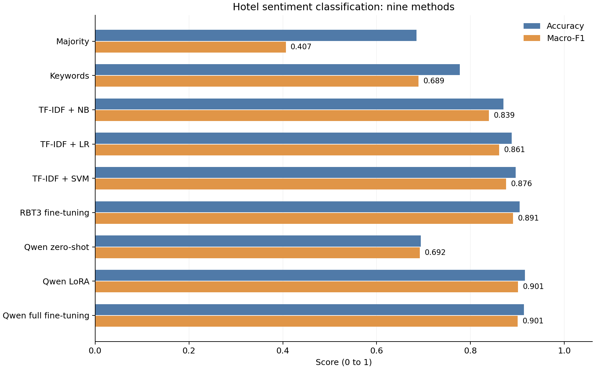
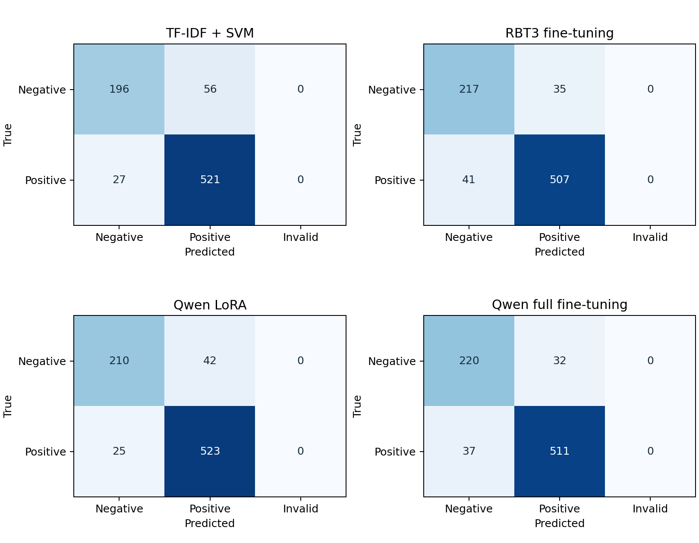

# Week06：中文酒店评论分类方法对比

本作业参考课程“数据接入与分流”的代码结构，实际完成规则、传统机器学习、预训练编码器和生成式大模型的分类对比。实验记录日期：2026-11-19。

与课堂示例相比，数据从 TNEWS 新闻 15 分类更换为 **ChnSentiCorp_htl_all 酒店评论情感二分类**；编码器从 bert-base-chinese 更换为 **hfl/rbt3**；生成模型从 Qwen3-0.6B 更换为 **Qwen2.5-0.5B-Instruct**。结果来自本目录代码实际运行，不使用老师提供的预测结果。任务和类别数量已变化，不能把本实验分数与课堂 TNEWS 分数直接比较。

## 1. 数据与实验设计

标签定义为 0＝负面、1＝正面。数据来源是 [ChineseNlpCorpus 的数据说明](https://github.com/SophonPlus/ChineseNlpCorpus/blob/master/datasets/ChnSentiCorp_htl_all/intro.ipynb)，该项目将 ChnSentiCorp 酒店评论整理为 CSV。源文件版本和 SHA256 见 [assets_manifest.json](assets_manifest.json)。

| 数据检查 | 数量 |
|---|---:|
| 原始评论 | 7,766 |
| 空评论，删除 | 1 |
| 标准化及截断后相同输入，删除重复项 | 2 |
| 相同输入但标签冲突，删除整组 | 0 |
| 清洗后唯一输入 | 7,763 |
| 未用于本次实验的剩余数据 | 4,163 |

所有方法使用 NFKC 标准化、去空白后的**前 200 个字符**。先统一截断和去重，再切分，避免两条不同长评论截断后变成相同输入却落入不同集合。原始数据中 1,308 条超过 200 字，截断可能丢失评论后半段的态度；这是本实验范围的一部分。

| 集合 | 负面 | 正面 | 合计 | 用途 |
|---|---:|---:|---:|---|
| 训练集 | 755 | 1,645 | 2,400 | 拟合 TF-IDF、分类器及微调参数 |
| 验证集 | 126 | 274 | 400 | 选择超参数或最佳 epoch |
| 测试集 | 252 | 548 | 800 | 最终比较 |

按原始类别比例分层抽样，固定 seed=42。训练、验证、测试输入交集为零。人工规则在测试前写定；所有监督方法使用完全相同的 2,400 条训练数据，没有在验证集上继续拟合。测试结果不用于修改词表、prompt 或训练超参数。

每个输入保存稳定 ID；每个集合保存包含 ID、文本、标签和顺序的 SHA256。汇总程序除了核对样本数，还核对整个集合指纹、逐条 ID 顺序、真实标签及重算指标。完整检查在 [data/manifest.json](data/manifest.json)。

## 2. 九组方法

| 方法 | 实现与目的 |
|---|---|
| 多数类 | 永远预测训练集多数类“正面”，显示类别不平衡的影响 |
| 情感词规则 | 固定正负面词表计数；同分回退多数类；负面短语先匹配，减轻“不舒服”与“舒服”的双重计数 |
| TF-IDF + MultinomialNB | 字符 1–2 gram，朴素贝叶斯基线 |
| TF-IDF + LogisticRegression | 相同特征下比较逻辑回归 |
| TF-IDF + LinearSVC | 相同特征下比较线性 SVM |
| RBT3 全量微调 | 3 层预训练编码器加随机初始化的二分类头，联合更新所有参数 |
| Qwen 零样本 | 固定分类指令，直接生成“正面”或“负面”，不训练 |
| Qwen LoRA | 冻结基础模型，仅训练注意力投影中的低秩适配参数 |
| Qwen 全量微调 | 相同基础模型、prompt、训练数据和轮数，更新全部参数 |

模型来源：[HFL RBT3 模型卡](https://huggingface.co/hfl/rbt3)、[Qwen2.5-0.5B-Instruct 模型卡](https://huggingface.co/Qwen/Qwen2.5-0.5B-Instruct)。实际下载的 commit revision 已锁定，权重不加入 Git。

### 训练配置

全部配置见 [config.json](config.json)，主要设置如下：

- TF-IDF：字符 1–2 gram、min_df=2、最多 50,000 个特征、sublinear_tf=True；仅在训练集 fit。NB 从 alpha={0.1,0.5,1.0} 中选择；LR 和 SVM 从 C={0.5,1.0,2.0} 中选择。
- RBT3：3 个 epoch，batch=32，学习率 3e-5，AdamW，weight_decay=0.01，10% warmup。以验证集 Macro-F1 选择最佳 epoch。
- Qwen 两种 SFT：2 个 epoch，micro batch=2，梯度累积 8 次，有效 batch=16，AdamW，weight_decay=0.01，10% warmup。LoRA 学习率 2e-4；全量微调 2e-5。学习率是不同训练方式的预设配置，因此这不是“仅改变可训练参数数量”的单变量实验。
- LoRA：r=8、alpha=16、dropout=0.05，作用于 q_proj/k_proj/v_proj/o_proj。
- 精度：RBT3 使用 FP32 权重和 BF16 autocast；Qwen 基础权重使用 BF16，LoRA 参数由 PEFT 管理；全量 Qwen 开启 gradient checkpointing。不同精度和优化器数值行为也可能影响结果。
- Qwen 训练与推理使用同一个 chat template；SFT 仅计算类别答案及 EOS 的损失，prompt/padding 标签为 -100。当前 tokenizer 将两个类别分别编码成一个 token。
- Qwen 使用 greedy decoding，最多生成 4 个 token；严格解析类别，允许外层标点，但拒绝含多个类别或解释的回答。

为适配 8 GB 显存，SFT 仅对答案对应位置展开完整词表 logits；前面的上下文仍完整参与注意力。测试验证了该优化与标准 masked causal-LM loss 的数值及梯度一致。累积窗口按答案 token 数归一化，最后不足一个窗口的批次也执行更新。

## 3. 实验结果

全部 9 组的实际结果、负面召回率、耗时、显存和配对区间见 **[完整结果表](results/summary.md)**。

逐条预测保存在 results 下对应方法的 JSON 中，可通过 ID 与 data/test.jsonl 连接。训练曲线记录、选中的 epoch、环境版本、参数量和计时口径都保存在同一结果文件内。

### 指标口径

Accuracy 的分母是全部 800 个测试输入。Macro-F1 对负面和正面两个类别等权平均；生成解析失败记为 -1，既计入准确率错误，也计入真实类别的漏判，不从分母中删除。另报告各类别 Precision/Recall/F1、包含失败列的混淆矩阵。

本实验保留自然类别比例，因此始终猜正面就有 68.5% Accuracy，但 Macro-F1 仅为 0.4065。不能只看准确率判断方法是否有效。

### 结果解读

**传统方法仍然是有竞争力的基线。** 同样的 TF-IDF 特征下，NB、LR、SVM 的 Macro-F1 分别为 0.8392、0.8612、0.8757。SVM 在这个固定子集上的表现最好；这不能推广为它在所有文本分类任务中都最好。

**RBT3 的收益较小，当前证据不足以确认稳定领先 SVM。** RBT3 的 Accuracy 为 0.9050、Macro-F1 为 0.8906，比 SVM 高 0.0149 Macro-F1；配对 bootstrap 的 95% 区间为 [-0.0094, 0.0392]，包含零。RBT3 第 3 轮训练损失继续下降，但验证 F1 低于第 2 轮，因此最终加载第 2 轮权重。

**零样本存在明显类别偏向，LoRA 能改善本次测试的分类结果。** Qwen 零样本的负面召回率为 98.02%，正面召回率只有 56.20%，将 548 条正面中的 240 条判成了负面。LoRA 的 Accuracy 为 0.9163、Macro-F1 为 0.9011，没有解析失败。LoRA 同样按验证集选中了第 1 轮，而非训练损失更低的第 2 轮。

**LoRA 与全量微调本次分数接近，训练资源消耗不同。** 全量微调按验证集选中第 2 轮，Accuracy 为 0.9137、Macro-F1 为 0.9006。全量减 LoRA 的 F1 差为 -0.0005，95% 配对区间为 [-0.0180, 0.0167]，不能据此证明两者稳定的优劣或统计等效。LoRA 本次分数最高，但这仍是单 seed 实验。

| Qwen 微调方式 | 可训练参数 | 训练/选模耗时 | 峰值 allocated 显存 | 负面召回率 |
|---|---:|---:|---:|---:|
| LoRA | 1,081,344（模型总参数约 0.22%） | 130.75 秒 | 1.61 GiB | 83.33% |
| 全量 | 494,032,768 | 200.18 秒 | 4.70 GiB | 87.30% |

因此，在当前样本量、硬件与配置下，LoRA 用较少训练资源取得了接近全量微调的整体分数；若业务更在意负面漏判，还应同时看负面召回率，而非仅凭总分选型。RBT3 和 TF-IDF 的本机推理时间更短，但表中计时包含的步骤及硬件不同，只能作为实现成本的参考。

### 错例分析

全部可定位错例见 [results/errors.json](results/errors.json)，以下摘录只用于解释现象：

| 测试输入 ID | 文本线索 | 原标签与观察 |
|---|---|---|
| 4093ef21a32b1c58cc02 | 前面提到接机收费和预订房间没有了，后面称升级套间“很大，很好”，并表示转机入住“还不错” | 原标签正面；零样本判负面，LoRA 和 RBT3 判正面。混合评价需要综合整体态度，不能只抓局部负面词 |
| e8050360d3f4690d7d68 | “对这个酒店的整体我不想多评论什么，希望携程在今后找合作酒店的时候多把把关” | 原标签负面；零样本、LoRA 和 RBT3 都判正面，委婉表达不满仍然困难 |
| 82f9ebd71a2a9cd56a57 | “房间日益陈旧”“地毯和浴室越来越脏”“早餐越来越差” | 原标签正面；上述三个模型都判负面。可能存在源标签噪声或输入截断造成的语义变化，不能仅凭此例认定标签错误 |

错例保留原始标签，没有在看到测试结果后修订标签、补规则或改 prompt。后续若人工复核，应另建有版本记录的数据集，并重新运行全部实验。

## 4. 复现方式

本机已使用仓库现有的 GPU 虚拟环境完成实验：

~~~bash
# 在仓库根目录运行
cd 孙燿烽/week06
../../.venv-transformer-gpu/bin/python run_all.py --offline --skip-existing
~~~

上面的命令校验已保存结果并重新生成汇总。若希望实际重新训练所有方法，去掉 --skip-existing；--offline 要求本地模型已下载。

在新环境中，先安装适合显卡的 PyTorch，再安装本目录依赖：

~~~bash
python -m pip install -r requirements.txt
python run_all.py
~~~

run_all.py 顺序执行下载、必要的数据准备、5 个基线、4 个神经网络实验及汇总。首次下载约 1.2 GB 资源，不需要 API key。也可以逐步运行：

~~~bash
python download_assets.py
python prepare_data.py
python run_baselines.py
python run_neural.py --method rbt3
python run_neural.py --method qwen_zero
python run_neural.py --method qwen_lora
python run_neural.py --method qwen_full
python summarize.py
python -m unittest -v test_core.py
~~~

修改切分、seed 或输入长度后，应重新运行 prepare_data.py 并重跑所有方法。旧结果与新数据或配置不一致时，程序会报错，不会将它们混在一起比较。--skip-existing 是按已完成的方法跳过，不提供训练 epoch 内断点续训。

实际环境：Python 3.12.14、PyTorch 2.14.1+cu130、Transformers 4.57.3、PEFT 0.18.0、scikit-learn 1.7.2，GPU 为 NVIDIA GeForce RTX 5060 Laptop GPU（8 GB）。完整版本记录在每份结果 JSON 的 environment 中。

本次完成了 9 组完整实验、全部 7,200 条测试预测的身份与指标复核，以及 10 项自动化回归检查。测试集只在选定模型后用于最终评测；汇总重算和图表生成不重新选择模型。

### 单条评论预测

~~~bash
python classify.py --method tfidf_svm --text "房间干净，交通方便，下次还会入住。"
python classify.py --method rbt3 --text "房间很脏，晚上太吵，以后不会再来了。"
python classify.py --method qwen_lora --text "服务不错，但是卫生和隔音令人失望。"
~~~

返回标签、实际输入和是否截断。该接口不把 SVM margin 或未校准 softmax 当作可靠置信度。使用训练过的方法前，需要本地 checkpoints 中存在对应权重。

## 5. 局限与可继续改进的方向

1. **一次切分和一个训练 seed**：bootstrap 区间只刻画固定模型下测试评论的抽样波动，不涵盖重新训练的随机性。不能把微小分数差直接解释为稳定优势。
2. **短文本范围**：所有方法只能看到前 200 字，结论不适用于完整长评论。
3. **公开数据与分组问题**：未做语义近重复聚类，没有可靠酒店 ID 用于按酒店划分；不能排除相似评论跨集合，也不能排除评论曾进入预训练语料。
4. **训练预算有限**：只使用 2,400 条标注数据，不是该数据集上的最优成绩；监督方法只做小范围选模。
5. **硬件耗时口径**：CPU 与 GPU、推理 batch 大小、tokenizer 是否提前执行均不同，表中时间仅反映本实现的实际运行，不是严格吞吐基准。GPU 显存是 PyTorch allocated 峰值，非 nvidia-smi 的总占用。
6. **可进一步验证**：重复多个 seed、扩大训练集、做相似评论分组切分、比较不同文本长度，再判断当前方法排序是否稳定。课件中的付费外部 API 路线不属于本次本地实验。

## 6. 文件说明

- common.py / prepare_data.py：统一数据与评测协议，清洗和分层切分。
- download_assets.py / assets_manifest.json：公开资源下载、固定版本和完整性校验。
- run_baselines.py / run_neural.py：传统分类器和神经网络训练评测。
- run_all.py / summarize.py：顺序复现、严格核对结果并生成表格和图片。
- classify.py：使用保存模型进行单条评论分类。
- test_core.py：数据泄漏、解析失败计分、答案 masking、loss 等价性等关键回归检查。
- data/：固定的 train/val/test 输入和清洗审计。
- results/：真实预测、训练记录、汇总表、配对区间、错例及图片。
- .cache/ / checkpoints/：下载资源和训练权重，保留本机并通过 .gitignore 排除。

课程参考代码位于 /home/flmae/Documents/learn/week6-数据接入与分流/code。本作业保留其“各方法共享数据与指标”的思路，并补充独立测试集、严格样本身份校验、失败预测的完整 F1 计分以及答案截断/梯度累积边界检查。
