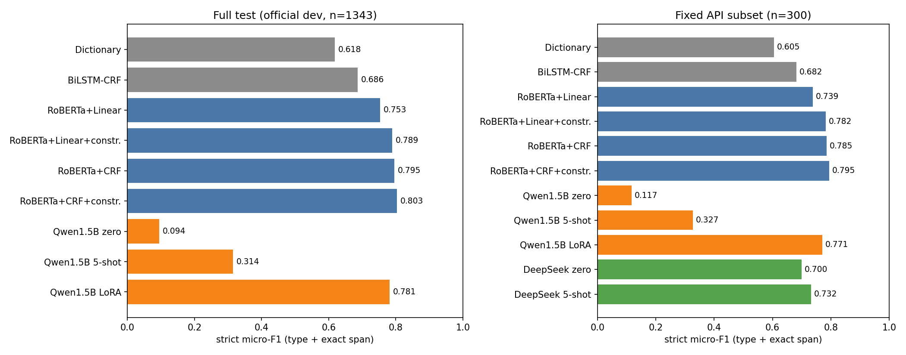
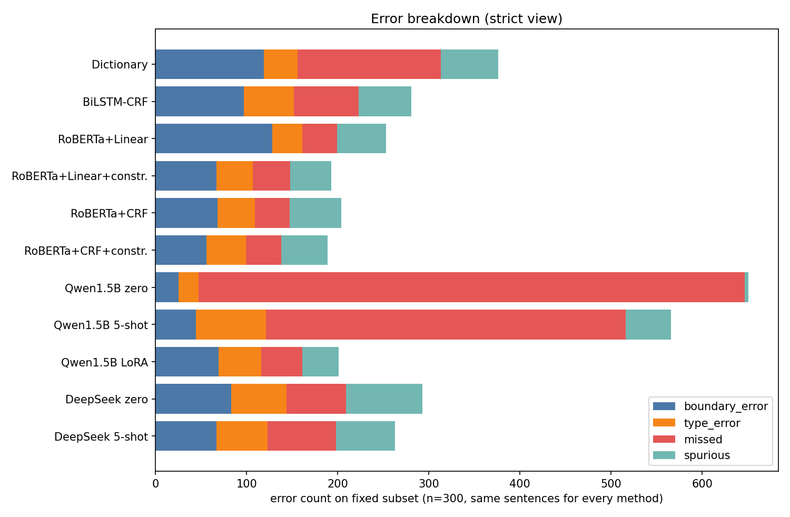

# Week07：中文细粒度命名实体识别方法对比（CLUENER2020）

本作业参考课程“信息抽取”的代码结构（同一份评测函数、生成式只输出文本再回填 offset、CRF 约束解码），换成**另一个数据集、另一组模型和另一个 API 模型**，实际完成规则、无预训练序列标注、预训练编码器、本地生成式大模型和云端 API 的抽取对比。实验记录日期：2026-11-26。

| | 课堂示例 | 本作业 |
|---|---|---|
| 任务 / 数据 | DuEE-Fin 金融公告事件抽取（13 类事件） | **CLUENER2020 细粒度 NER（10 类实体）** |
| 编码器 | bert-base-chinese | **hfl/chinese-roberta-wwm-ext** |
| 本地生成模型 | Qwen3-0.6B | **Qwen2.5-1.5B-Instruct** |
| API | DeepSeek（deepseek-v4-flash） | DeepSeek（**deepseek-flash**，调用时 `/models` 实际返回的模型名） |

所有数字来自本目录代码的实际运行，没有使用课程提供的预测结果。任务和数据都不同，**不能把本实验的 F1 与课堂 DuEE-Fin 的论元 F1 直接比较**。

## 1. 数据与实验设计

数据来自 CLUENER2020 官方压缩包（`cluener_public.zip`，SHA256 见 [assets_manifest.json](assets_manifest.json)），10 类实体：地址 address、书名 book、公司 company、游戏 game、政府机构 government、影视作品 movie、人名 name、组织机构 organization、职位 position、景点 scene。

官方测试集没有公开标注，因此：

| 集合 | 来源 | 句数 | 实体数 | 用途 |
|---|---|---:|---:|---|
| 训练集 | 官方 train 去掉验证集 | 9,748 | 21,725 | 词典、BiLSTM/RoBERTa 训练、LoRA SFT、少样本示例 |
| 验证集 | 官方 train 按 seed=42 抽 1,000 句 | 1,000 | 2,244 | 选 epoch、选规则阈值、选 offset 回填策略 |
| 测试集 | **官方 dev 全部** | 1,343 | 3,072 | 最终比较 |
| API 子集 | 测试集中 seed=42 抽 300 句 | 300 | — | 所有方法在同一批句子上与 API 并排比较 |

数据审计（完整记录在 [data/manifest.json](data/manifest.json)）：

- 三个集合之间**文本交集为零**；每个实体都校验 `text[start:end] == 实体文本`；BIO 往返（span → BIO → span）全部一致。
- CLUENER 原始 `end` 是闭区间，统一转为左闭右开。
- 重叠实体只有 1 句（训练集 `train-01506`：书名里嵌套两个公司名），保留外层书名、丢弃 2 个内层实体；测试集不受影响。
- 每句至少一个实体，最长 50 字，平均 37 字。
- **标注惯例**：训练集中书名、影视、游戏类实体有 97% **连同书名号《》一起标注**（例：`《三国演义》`）。这一点在写 prompt 和规则之前从训练集统计得到，并写进了两者。

所有输出（含 LLM 的空回复、解析失败）都以「每句一行」留在预测文件中，由同一个 `common.evaluate()` 计分，不从分母中删除。

## 2. 十一组方法

| 方法 | 实现与目的 |
|---|---|
| 训练集词典匹配 | 训练集实体建词典、正向最长匹配；按「被标注比例」过滤歧义词（阈值在验证集上选）；另加《》片段 + 上下文线索词定类型。说明“不用模型能到多少” |
| 字符 BiLSTM-CRF | 随机初始化字向量 → BiLSTM → 手写 CRF。说明“没有预训练能到多少” |
| RoBERTa-wwm + Linear | 预训练编码器逐字发射分数，每个位置独立 argmax |
| RoBERTa-wwm + Linear + 约束解码 | **同一 checkpoint 不重训**，只把解码换成禁止非法 BIO 转移的维特比 |
| RoBERTa-wwm + CRF | 编码器 + CRF 联合训练，维特比解码 |
| RoBERTa-wwm + CRF + 约束解码 | 同一 CRF checkpoint，解码时把非法转移分数置为 −∞ |
| Qwen2.5-1.5B 零样本 | 本地生成，system prompt 给出 10 类定义和输出格式，输出 `{类型: [实体文本]}` 的 JSON |
| Qwen2.5-1.5B 少样本 | 同一 prompt + 5 条训练集示例（贪心覆盖全部 10 类，排除书名号不配对的噪声样本） |
| Qwen2.5-1.5B LoRA | 用零样本 prompt 作输入、金标 JSON 作答案做 SFT，只对答案和结束符计 loss |
| DeepSeek API 零样本 | 与本地零样本**同一份 prompt、同一个解析器和回填规则** |
| DeepSeek API 少样本 | 与本地少样本同一组 5 条示例 |

模型来源：[hfl/chinese-roberta-wwm-ext](https://huggingface.co/hfl/chinese-roberta-wwm-ext)、[Qwen2.5-1.5B-Instruct](https://huggingface.co/Qwen/Qwen2.5-1.5B-Instruct)，经 hf-mirror 下载，commit revision 与文件 SHA256 锁定在 assets_manifest.json，权重不加入 Git。

### 训练与推理配置

全部配置见 [config.json](config.json)：

- **词典**：`min_count ∈ {1,2,3}` × `min_label_ratio ∈ {0, 0.1, 0.3, 0.5, 0.7}` 网格，验证集 strict F1 选择，选中 `min_count=1, min_label_ratio=0.1`（10,188 个词条）。首轮网格最优落在 0.3 的边界，于是按验证集把候选扩展到 0 和 0.1，选择仍只看验证集。
- **BiLSTM-CRF**：字向量 128、每方向隐层 256、dropout 0.3、Adam 1e-3、batch 64、20 轮，按验证集选轮次。
- **RoBERTa**：逐字映射到词表 id（字符与 token 严格一一对应，测试集 UNK 率 0.85%），4 轮、batch 32、编码器 lr 3e-5、分类头与 CRF lr 1e-3、AdamW、weight decay 0.01、10% warmup、BF16 autocast（CRF 用 FP32），按验证集 strict F1 选轮次。Linear 与 CRF 两个头的训练预算完全相同。
- **约束解码**：句首不能是 `I-x`，`I-x` 只能接在 `B-x / I-x` 之后；Linear 版在 log-softmax 上跑约束维特比，CRF 版在学到的转移矩阵上叠加约束。CRF 前向算法与维特比经暴力枚举全部路径验证一致（test_core.py）。
- **Qwen 推理**：BF16、贪心解码、最多生成 160 token（训练集最长答案 60 token），批量 32、按 prompt 长度分桶左补齐。
- **Qwen LoRA**：r=16、alpha=32、dropout 0.05，作用于 q/k/v/o/gate/up/down 投影；lr 2e-4、AdamW、weight decay 0.01、5% warmup；micro batch 8 × 梯度累积 2（有效 batch 16）、2 轮、gradient checkpointing；每轮在全部 1,000 条验证集上生成并按 strict F1 选轮次。只为答案位置展开 15 万维词表 logits，测试验证其 loss 与梯度和标准 masked causal-LM loss 一致。
- **DeepSeek**：`deepseek-flash`、temperature 0、max_tokens 256、关闭 thinking（课程代码记录了 flash 档位默认先输出思考、正文可能为空的问题）、4 路并发；响应按样本缓存在 [results/api_raw/](results/api_raw/)，重跑不重复计费。

### 生成式输出如何变成 span

模型只输出实体**文本**，不输出下标；程序在原文中查找并回填（长片段优先占位，避免“北京”抢走“北京大学”的位置）。同一文本在句中出现多次时有两种回填策略，用金标反推上限、**只在验证集上选择**：

| 回填策略 | 验证集上限 F1 | 测试集上限 F1 |
|---|---:|---:|
| first：只取第一次出现 | 0.9849 | 0.9835 |
| **all：取所有出现位置（选中）** | **0.9967** | 0.9963 |

即生成式方法在本口径下最多只会因回填损失约 0.4 个点。解析器容忍代码围栏、截断 JSON（补引号和括号）与中文类型别名；不在 10 类中的键、原文中找不到的文本被丢弃并计数。

## 3. 实验结果

完整表格见 **[results/summary.md](results/summary.md)**（含 P/R、边界 F1、文本 F1、各类型 F1、耗时、显存）。

### 指标口径

- **strict F1（主指标）**：类型 + 起点 + 终点完全一致才算对，按实体做 micro 平均。
- **Macro-F1**：10 类 strict F1 等权平均，观察长尾类型。
- **边界 F1**：只看起止、不看类型；**文本 F1**：按 `(类型, 实体文本)` 集合比较，不受同文本多次出现的回填方式影响。
- **非法转移**：序列标注原始输出中违反 BIO 的位置数。
- 配对 bootstrap：按句重采样 2,000 次（seed=42），报告 strict micro-F1 差值的 95% 区间。它只反映测试句子的抽样波动，不含重新训练的随机性。

### 完整测试集（1,343 句）

| 方法 | P | R | **strict F1** | Macro-F1 | 非法转移 | 训练/选模秒 | 毫秒/句 | 峰值显存 GiB |
|---|---:|---:|---:|---:|---:|---:|---:|---:|
| 训练集词典匹配 | 0.6530 | 0.5863 | **0.6178** | 0.5940 | 0 | 1.4 | 0.05 | 0 |
| 字符 BiLSTM-CRF | 0.6928 | 0.6797 | **0.6862** | 0.6828 | 18 | 61.3 | 0.09 | 0.17 |
| RoBERTa-wwm + Linear | 0.7246 | 0.7829 | **0.7526** | 0.7517 | 257 | 85.9 | 0.40 | 2.06 |
| RoBERTa-wwm + Linear + 约束解码 | 0.7822 | 0.7962 | **0.7892** | 0.7898 | 0 | 0（复用） | 0.49 | 2.06 |
| RoBERTa-wwm + CRF | 0.7800 | 0.8115 | **0.7955** | 0.7925 | 70 | 100.7 | 0.49 | 2.06 |
| RoBERTa-wwm + CRF + 约束解码 | 0.7938 | 0.8132 | **0.8033** | 0.8012 | 0 | 0（复用） | 0.49 | 2.06 |
| Qwen2.5-1.5B 零样本 | 0.4020 | 0.0534 | **0.0943** | 0.0992 | — | 0 | 70.95 | 4.04 |
| Qwen2.5-1.5B 少样本 | 0.4907 | 0.2308 | **0.3139** | 0.3185 | — | 0 | 126.78 | 4.84 |
| Qwen2.5-1.5B LoRA | 0.7765 | 0.7858 | **0.7811** | 0.7814 | — | 5,347.3 | 108.05 | 5.95 |

### 固定 300 句子集（含 API，所有方法同一批句子）

| 方法 | **strict F1** | 边界错 | 类型错 | 漏抽 | 多抽 | 空预测句 | JSON 合法率 | 原文找不到 |
|---|---:|---:|---:|---:|---:|---:|---:|---:|
| 训练集词典匹配 | **0.6048** | 119 | 37 | 157 | 63 | 19 | — | — |
| 字符 BiLSTM-CRF | **0.6823** | 97 | 55 | 71 | 58 | 9 | — | — |
| RoBERTa-wwm + Linear | **0.7387** | 128 | 33 | 38 | 54 | 1 | — | — |
| RoBERTa-wwm + Linear + 约束解码 | **0.7824** | 67 | 40 | 41 | 45 | 1 | — | — |
| RoBERTa-wwm + CRF | **0.7850** | 68 | 41 | 38 | 57 | 1 | — | — |
| RoBERTa-wwm + CRF + 约束解码 | **0.7948** | 56 | 43 | 39 | 51 | 1 | — | — |
| Qwen2.5-1.5B 零样本 | **0.1169** | 25 | 22 | 600 | 4 | 243 | 100% | 20 |
| Qwen2.5-1.5B 少样本 | **0.3265** | 44 | 77 | 395 | 50 | 105 | 100% | 33 |
| Qwen2.5-1.5B LoRA | **0.7712** | 69 | 47 | 45 | 40 | 0 | 100% | 1 |
| DeepSeek API 零样本 | **0.6997** | 83 | 61 | 65 | 84 | 14 | 100% | 5 |
| DeepSeek API 少样本 | **0.7321** | 67 | 56 | 75 | 65 | 11 | 100% | 0 |

错误按 strict 口径归为四类：起止与金标重叠但不一致（边界错）、起止一致但类型不同（类型错）、金标没有任何重叠预测（漏抽）、预测与任何金标都不重叠（多抽）。300 句共 690 个金标实体。「原文找不到」统计的是模型输出了但原文中不存在、因而被丢弃的实体文本。表中所有列都只统计这 300 句；全测试集上 Qwen 零样本 / 少样本 / LoRA 的 JSON 合法率为 99.4% / 99.3% / 100%，原文找不到分别为 71 / 129 / 4 个。

### 结果解读

**每加一层建模都有显著收益。** 词典 0.6178 → BiLSTM-CRF 0.6862（+6.8 点，95% 区间 [+5.0, +8.7]）→ RoBERTa + Linear 0.7526（+6.7 点，[+4.9, +8.5]）。词典的问题主要是漏抽（300 句中 157 个）：测试集 37.2% 的实体文本从未在训练集标注中出现，词典天然覆盖不到；BiLSTM 能泛化到新词但边界错仍多；预训练编码器在人名（0.864 vs 0.728）、书名（0.798 vs 0.664）等需要语义的类型上提升最大。

**约束解码是本次最便宜的提升。** 同一个 RoBERTa + Linear checkpoint，不重训、只把 argmax 换成禁止非法 BIO 转移的维特比：257 处非法转移归零，strict F1 0.7526 → 0.7892（+3.7 点，[+2.9, +4.4]），子集上的边界错从 128 降到 67。逐位 argmax 会产生 `B-company I-organization` 这类断裂序列，宽松解码把它切成两个错实体，所以非法序列直接伤害边界，而不只是“不好看”。CRF 已经学到大部分转移结构（非法转移 70 处），再加约束只多 +0.8 点（[+0.5, +1.1]），但仍然稳定为正。RoBERTa + CRF + 约束解码 0.8033 是全测试集最高分，与 CLUENER 论文中 BERT 类基线的量级一致（任务划分不同，不作直接比较）。

**本地 1.5B 模型不微调基本不可用；LoRA 后接近判别式。** 零样本 JSON 合法率 99.4%，格式不是问题，问题是不敢抽：1,343 句中 1,055 句输出 `{}`，召回只有 5.3%。5 条示例把 F1 提到 0.3139（+22.0 点），但仍有 485 句空输出，并出现 134 个 schema 外的类型键（最常见的是把人名写成通用 NER 标签 `person`，70 次）。LoRA（2 轮、9,748 条、只训练 1.18% 参数）把同一个模型提到 **0.7811**（比零样本 +68.7 点），JSON 合法率 100%、0 句空输出、类型全部合法；但仍比 RoBERTa + CRF + 约束解码低 2.2 点，且区间 [−3.5, −0.9] 不含零，本次不能说 LoRA 追平了判别式。

**DeepSeek API 零样本已有可用水平，但不如在本数据上训练过的小模型。** 在同一 300 句上：API 零样本 0.6997，比本地 1.5B 零样本高 58.3 点；少样本 0.7321（+3.2 点，[+0.6, +6.1]）。但它低于 RoBERTa + CRF + 约束解码 6.3 点（[+2.9, +9.7]），也低于 Qwen LoRA 3.9 点（[+0.5, +7.4]）。差距主要来自 CLUENER 自己的标注口径：API 的人名 F1 最高（0.92），而地址只有 0.46，16 个地址边界错里有 15 个是金标更长（CLUENER 常把复合地址整体标成一个实体，训练集 2,610 个地址中有 285 个长度 ≥10 字，例如 dev-00102 连“位于”都在实体内；大模型按常识拆成景点 + 地址）。**大模型懂“什么是实体”，但不知道这个数据集“怎么切实体”；这类口径只能靠标注数据或大量示例教给模型。**

**生成式链路的工程问题要单独计量。** 本地少样本在全测试集有 129 个输出文本在原文中找不到（改写或编造 72 个，如“枪手”写成“阿森纳”；给无书名号的标题补《》38 个；输出“无”这类占位 19 个）；API 零样本在 300 句上有 5 个，全部是给原文没有书名号的标题加上了《》（prompt 要求“带书名号时连同《》一起抽取”被理解成了“加书名号”）；LoRA 在全测试集有 4 个，都是把原文改写成规范说法（“枪手”→“阿森纳”、“董事会主席”→“董事长”）。这些都被「必须是原文片段」的校验挡掉、计为漏抽。生成式抽取必须有类型白名单和原文校验两道关，否则会把不存在的字符串写进下游。

**选型取舍。** 在 8 GB 笔记本 GPU 上，RoBERTa + CRF 训练 1.7 分钟、推理约 0.5 ms/句、F1 最高；Qwen LoRA 训练 89 分钟、推理约 108 ms/句（约 220 倍）、F1 低 2.2 点，但它的输出形式更灵活（换 schema 只需改 prompt 和训练数据）；DeepSeek 不需要任何训练与 GPU，约 1 秒/条，适合冷启动或标注数据很少时先用，量大且口径固定后再换成训练过的小模型。

### 成本

| 方法 | 训练 | 推理 | 资源 |
|---|---|---|---|
| 训练集词典匹配 | 1.4 秒（建词典 + 15 组网格） | 0.05 ms/句，CPU | 无模型 |
| 字符 BiLSTM-CRF | 61 秒（20 轮） | 0.09 ms/句 | 1.26M 参数，权重 4.9 MB，峰值显存 0.17 GiB |
| RoBERTa-wwm + CRF（+ 约束解码） | 101 秒（4 轮） | 0.49 ms/句 | 102M 参数，权重 391 MB，峰值显存 2.06 GiB |
| Qwen2.5-1.5B 零样本 / 少样本 | 无 | 71 / 127 ms/句（批量 32） | 1.54B 参数，峰值显存 4.04 / 4.84 GiB；prompt 平均 376 / 653 token |
| Qwen2.5-1.5B LoRA | 5,347 秒（2 轮 1,220 步，含两次验证集生成） | 108 ms/句 | 可训练 18.5M（1.18%），adapter 71 MB，峰值显存 5.95 GiB |
| DeepSeek 零样本（300 句） | 无 | 平均 1.02 s/条，p95 1.44 s；4 路并发墙钟 81 s | prompt 100,643 token（缓存命中 38,400）+ 输出 5,558 token |
| DeepSeek 少样本（300 句） | 无 | 平均 0.94 s/条，p95 1.32 s；墙钟 81 s | prompt 178,343 token（缓存命中 114,688）+ 输出 5,055 token |

计时为单次实测：序列标注的推理时间包含批量前向与解码、不含权重加载；Qwen 包含 chat template、tokenize 与生成；API 是单条请求往返延迟（含网络）。三者硬件与批大小不同，只能作为本实现的成本参考，不是严格吞吐基准。显存是 PyTorch allocated 峰值，不是 nvidia-smi 的总占用。LoRA 训练早期触发过一次 CUDA 分配器 OOM 警告（释放缓存后重试成功，训练未中断），说明 micro batch 8 在 8 GB 卡上已接近上限。

API 金额没有写进表：查到的 DeepSeek 价格存在峰谷分时和近期调价，且官方价目页未直接列出 `deepseek-flash` 这个 ID，无法可靠换算；实际花费以 DeepSeek 控制台账单为准。上表 token 数来自 API 返回的 `usage`，可复核。

## 4. 错例分析

全部可定位错例见 [results/errors.json](results/errors.json)（300 句子集上每个方法的边界错 / 类型错 / 漏抽 / 多抽明细）。以下 10 例在看到测试结果后摘录，只用于解释现象，**没有据此修改 prompt、规则、标签或训练配置**：

| # | 测试 ID | 原文片段 | 金标 | 预测（RoBERTa-CRF-约束 / DeepSeek 少样本 / Qwen LoRA） | 归类 |
|---|---|---|---|---|---|
| 1 | dev-00102 | 大西洋新城聆湖苑位于朝阳区望京南湖南路10号 | address：整段（含“位于”） | 三者都拆成 `大西洋新城聆湖苑` + `朝阳区望京南湖南路10号`（DeepSeek 把前者判为 scene） | **边界·标注粒度**：数据集口径偏长，模型按常识切分 |
| 2 | dev-00138 | 向第十一届全国人大常委会作《 | government：`全国人大常委会` | 三者都是 `第十一届全国人大常委会` | **边界·修饰语**：届次前缀是否属于机构名，口径不统一 |
| 3 | dev-00116 | ID“ZSMJ”…现LGD.sGty战队队长 | name：`“ZSMJ”`；organization：`现LGD.sGty战队` | DeepSeek、LoRA 给出 `ZSMJ`、`LGD.sGty战队`；RoBERTa 漏掉 ID | **边界·金标噪声**：金标带引号和“现”字，模型输出反而更合理 |
| 4 | dev-00061 | 行程为马久邑-富美邑-磻溪-古生-海舌-沙村-喜洲 | 8 个 scene | 三者全部判为 address | **类型混淆·景点/地址**：村落作为旅游点时标 scene，三种方法一致判错 |
| 5 | dev-00118 | 大众软件：你好…杂志《大众软件》 | book：`大众软件`、`《大众软件》` | RoBERTa 两个都对；DeepSeek 把无书名号的判为 organization；LoRA 漏掉 | **类型混淆·无书名号刊名**：同名的杂志与公司难分 |
| 6 | dev-00096 | 李安“奥斯卡最佳导演”…提名最佳导演 | position：`导演` ×2 | DeepSeek 抽成一个 `奥斯卡最佳导演`；RoBERTa、LoRA 多抽 organization `奥斯卡` | **边界·粒度 + 多抽**：奖项名是否算组织、头衔取多长 |
| 7 | dev-00001 | 2比1战胜曼联之后枪手仍然留在… | 未标 `枪手` | RoBERTa、DeepSeek 抽出 organization `枪手`；LoRA 未抽 | **多抽·标注不一致**：阿森纳的绰号，训练集中“枪手”出现 21 次、其中 10 次标为 organization |
| 8 | dev-00004 | 站在雪山脚下…巍峨的雪山所震撼 | scene `雪山` 只标第一次 | DeepSeek、LoRA 按“全部出现”回填两次（多 1 个）；RoBERTa 两次都漏 | **重复提及**：金标对重复实体标注不一致，回填策略的代价 |
| 9 | dev-00131 | 被国人称为《半条命人质版》的反恐精英初代作品 | game：`《半条命人质版》`、`反恐精英` | 三者都漏掉 `反恐精英` | **漏抽·无书名号游戏名**：没有《》提示时游戏名难识别 |
| 10 | dev-00014 | 以目前枪手的能力和状态 | 未标 `枪手` | LoRA 输出 organization `阿森纳`（原文没有，被校验丢弃） | **生成式改写**：模型用知识替换原文说法；同类还有“董事会主席”→“董事长” |

另有两类只在未微调的生成式模型中出现：API 零样本给无书名号的标题补《》（如 dev-00234 的 `夜幕降临前》` 被写成 `《夜幕降临前》`）；Qwen 少样本输出 `{"person": ["程阳"]}` 这类 schema 外类型（dev-00008）。两者都被解析器丢弃，记为漏抽。

**归纳**：判别式模型的主要错误是**边界**（尤其长地址）和**景点/地址、组织/政府**类型混淆；生成式模型的主要错误是**标注口径不一致**（拆分长实体、带不带修饰语）和**输出不是原文**。有不少“错误”来自金标本身（例 3、7、8），strict 口径会把它们全部算作模型错误——这也是报告边界 F1、文本 F1 的原因。

## 5. 复现方式

本机已使用仓库现有的 GPU 虚拟环境完成实验：

~~~bash
# 在仓库根目录运行
cd 孙燿烽/week07
../../.venv-transformer-gpu/bin/python run_all.py --offline --skip-existing
~~~

上面的命令校验已保存结果并重新生成汇总；去掉 `--skip-existing` 则重新训练所有方法（API 结果有缓存，不会重复计费）。

在新环境中，先安装适合显卡的 PyTorch，再：

~~~bash
python -m pip install -r requirements.txt
# 可选：在 week07/.env 写入 DEEPSEEK_API_KEY=sk-...（已被 .gitignore 忽略）；不写则跳过 API 两组
python run_all.py
~~~

也可以逐步运行：

~~~bash
python download_assets.py               # CLUENER 官方包 + 两个模型（经 hf-mirror，锁定 revision）
python prepare_data.py                  # 切分、审计、选回填策略、抽 API 子集
python run_rule.py
python run_sequence.py --method bilstm_crf
python run_sequence.py --method roberta_linear   # 同时产出 *_constrained
python run_sequence.py --method roberta_crf
python run_llm_local.py --method qwen_zero
python run_llm_local.py --method qwen_few
python run_llm_local.py --method qwen_lora
python run_api.py --check               # 只列可用模型，不计费
python run_api.py --mode zero
python run_api.py --mode few
python summarize.py
python -m unittest -v test_core.py
~~~

单句抽取：

~~~bash
python extract.py --method roberta_crf --constrained --text "浙商银行行长叶老桂在杭州出席了《财经》杂志的发布会。"
python extract.py --method qwen_lora --text "《王者荣耀》的玩家在成都举办了线下赛。"
python extract.py --method deepseek_few --text "故宫博物院院长王旭东接受了采访。"
~~~

返回每个实体的类型、文本与左闭右开 offset；生成式方法额外返回原始输出与解析统计。

实际环境：Python 3.12.14、PyTorch 2.14.1+cu130、Transformers 4.57.3、PEFT 0.18.0，GPU 为 NVIDIA GeForce RTX 5060 Laptop GPU（8 GB）。每份结果 JSON 的 `environment` 字段记录了完整版本。

## 6. 局限

1. **一次切分、一个训练 seed**：bootstrap 区间只描述测试句子的抽样波动，不含重新训练的随机性。约束解码 +0.8 点这类小差距在不同 seed 下可能变化。
2. **API 只跑了 300 句**：为控制费用，DeepSeek 只评测固定子集；它与其他方法的比较只在子集表和子集配对区间中进行，不能与全测试集的数字混排。API 模型版本由服务端决定，日后重跑可能得到不同结果（原始响应已保存在 results/api_raw/）。
3. **训练预算未充分搜索**：RoBERTa + CRF 和 BiLSTM 都在最后一轮取得验证集最佳，继续训练可能还会提高；LoRA 只跑 2 轮、只试了一组超参数；Qwen 只用了 1.5B，没有比较更大的本地模型或全量微调（8 GB 显存放不下 1.5B 的全量 AdamW 状态）。
4. **prompt 只设计了一版**：为避免用测试集调 prompt，所有生成式方法用同一份在看到结果前写定的 prompt。「连同《》一起抽取」这句在 API 零样本上带来了 5 个补书名号的副作用；更好的 prompt 应在验证集上迭代，本次未做。
5. **标注噪声与口径**：错例分析显示金标存在漏标、引号/修饰语不一致、重复实体只标一次等情况；strict 口径对所有方法同等计分，但对擅长按常识切分的大模型更不利。我们没有修改任何标签。
6. **测试集即官方 dev**：官方 test 无公开标注，无法报告榜单口径的分数；验证集从官方 train 切出，与测试集分布一致但规模较小。
7. **耗时不是严格基准**：CPU/GPU、批大小、是否含 tokenize 都不同；API 延迟还受网络与服务端负载影响。

## 7. 文件说明

- common.py：标签体系、BIO 转换与合法性、唯一评测函数（strict / 边界 / 文本三种口径）、错误归类、结果保存。
- crf.py：手写线性链 CRF（前向算法、维特比、解码期约束）。
- llm_common.py：生成式共用的 prompt、少样本挑选、容错解析和 offset 回填。
- download_assets.py / assets_manifest.json：数据与模型下载、版本锁定与完整性校验。
- prepare_data.py：格式转换、切分、数据审计、回填策略选择、API 子集。
- run_rule.py / run_sequence.py / run_llm_local.py / run_api.py：四条方法链路。
- run_all.py / summarize.py：顺序复现、逐条核对样本身份与配置后重算指标，生成表、配对区间、错例和图。
- extract.py：单句抽取接口。
- test_core.py：CRF 暴力枚举验证、约束解码零非法、BIO 往返、指标口径、解析/回填、SFT loss 等价、数据泄漏等 13 项检查。
- data/：固定的 train/val/test、API 子集 ID 与审计清单；results/：逐条预测、训练曲线、汇总表、配对区间、错例、API 原始响应与图。
- .cache/ / checkpoints/ / .env：下载资源、训练权重与 API key，仅保留在本机，均被 .gitignore 排除。

课程参考代码位于 /home/flmae/Documents/learn/week7-信息抽取/code。本作业沿用其“唯一评测口径、生成式只输出文本再回填、CRF 硬约束解码”的思路，换用 NER 数据集与不同模型，并补充了独立的验证/测试划分、回填策略的上限分析、同批子集上的配对 bootstrap，以及 API 响应缓存。
