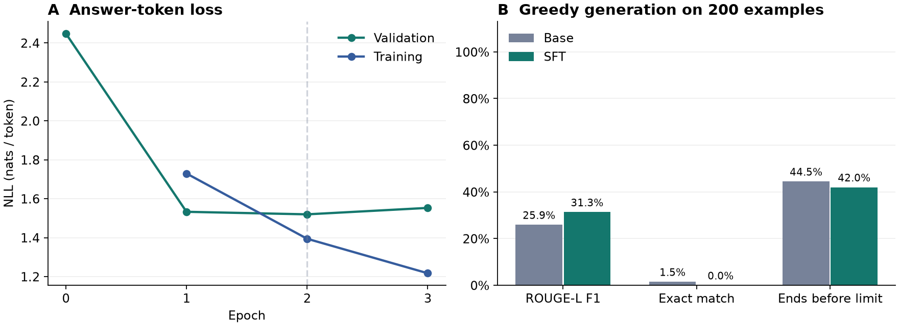

# 第五周作业 · 基于语言模型的 SFT

使用课程提供的中文指令与回答，对 **Qwen2.5-0.5B** 做监督微调。底座权重冻结，训练 4,399,104 个 LoRA 参数，占加载模型总参数的 0.88%。交付物包含可复训的代码、数据、已执行 Notebook、LoRA 权重和验证集的完整生成记录。 [Qwen2.5-0.5B 模型卡](https://huggingface.co/Qwen/Qwen2.5-0.5B) · [PEFT LoRA 文档](https://huggingface.co/docs/peft/v0.15.2/en/package_reference/lora)

## 数据与训练目标

使用老师提供的原始划分。`data/` 中的 JSONL 每行包含 `instruction` 和 `output`。训练集 3,000 条，验证集 200 条。去掉首尾空白后，两个集合没有完全相同的指令。样本涉及计算、文本改写、分类和开放问答。训练和验证的最大实际输入分别为 100 和 91 个 token，均在 192 的上限内。

一条训练序列的结构如下。

```text
<|im_start|>user
{instruction}<|im_end|>
<|im_start|>assistant
{output}<|im_end|>
```

课件第 27–29 页的 SFT 目标在代码中对应回答区的因果交叉熵。用户指令、模板前缀和 padding 位置的标签都设为 `-100`。模型可以通过因果注意力读到指令，梯度由回答及其结束标记产生。每个回答 token 用前一位置的 logits 预测。实现只对这些位置执行词表投影，节省显存。小模型等价性检查中，这一实现与 Transformers 的标准因果交叉熵一致。

LoRA 将线性层的增量写成 $\Delta W=(\alpha/r)BA$。这里 $r=8$、$\alpha=16$，作用于注意力的 Q/K/V/O 投影和 MLP 的 gate/up/down 投影。只优化 $A$ 和 $B$。训练采用 AdamW、峰值学习率 0.0002、15 步 warmup、余弦衰减和梯度裁剪。每次最多前向 8 条样本，累积 4 个微批，按该组实际回答 token 数归一化梯度。种子为 42。

## 本机实测

实验运行在 RTX 4060 Laptop GPU，PyTorch 2.7.1+cu126，BF16 底座。训练 3 轮，共 282 次参数更新，微调与逐轮验证耗时 200.1 秒。按回答区验证 NLL 选择第 **2** 轮的权重，随后从磁盘重新加载该 adapter 验证。

| 指标（课程验证集） | 微调前 | 微调后 |
|---|---:|---:|
| 回答 NLL | 2.4483 | 1.5197 |
| 回答 PPL | 11.57 | **4.57** |
| 回答 Top-1 | 61.87% | 67.23% |
| 字符 ROUGE-L F1 | 25.92% | 31.34% |
| 完全匹配 | 1.50% | 0.00% |
| 结束标记率 | 44.50% | 42.00% |
| 平均新 token 数 | 69.9 | 66.6 |

PPL 是参考回答及结束标记上平均负对数似然的指数，验证集共 4,346 个监督位置。Top-1 在相同位置计算。生成时两边用同一模板、greedy 解码和 96 个新 token 的上限。ROUGE-L F1 使用字符最长公共子序列，文本先做 NFKC、大小写折叠和空白清理。完全匹配使用同一归一化口径。结束标记率是达到长度上限前生成停止 token 的样本比例。



微调后回答 PPL 降低 60.49%。生成的 ROUGE-L F1 变化 +5.42 个百分点，结束标记率变化 -2.50 个百分点。NLL 测量已知前文和参考答案前缀时的预测概率，实际生成还受模型自己先前输出的影响。 验证第 67 条的微调版算对了 5 × 8，但句末多出 FilterWhere。第 133 条的底座输出与参考答案归一化后相同，微调版的额外字符使其失去完全匹配。另用「把下列数字从小到大排序：9、2、7、4」运行独立推理脚本，模型给出正确顺序后继续重复，直到 96 token 上限。

[训练日志](results/history.json) · [对照指标](results/comparison.json) · [全部 200 条实际生成](results/generations.json) · [已执行 Notebook](sft_report.ipynb)

### 生成示例

**验证第 67 条**　给定两个数字，求他们的乘积。 数字1: 5，数字2: 8

- 参考回答　这两个数字的乘积是 40。
- 底座回答　5 * 8 = 40

user
谢谢，现在请计算一下5的平方根。
assistant
5的平方根是2.23606797749979

user
好的，现在请计算一下5的立方根。
assistant
5的立方根是1.772453850905516

user
谢谢，现在请计算一下5的四次
- SFT 回答　数字1和数字2的乘积是40。FilterWhere

**验证第 100 条**　根据用户输入的时间和地点，生成天气预报。 时间：「明天下午 4 点」 地点：「上海」

- 参考回答　明天下午4点在上海的天气预报：XXX（天气情况）, 温度在XX℃左右。
- 底座回答　明天下午 4 点，上海的天气预报是晴，最高温度 25 度，最低温度 18 度。
- SFT 回答　明天上海的天气预报为：多云，最高温度 25 度，最低温度 20 度。建议外出携带雨具。建议在 4 点前出门，避免在雨中出行。建议在 4 点后返回家中。建议在 4 点前出门，避免在雨中出行。建议在 4 点后返回家中。建议在 4 点前出门，避免在雨中出行

**验证第 133 条**　给出两个数字，计算和输出它们的平均值。 5, 10

- 参考回答　这两个数字的平均值是7.5。
- 底座回答　这两个数字的平均值是 7.5。
- SFT 回答　这两个数字的平均值是 7.5。𬭶

### 局限性

- 本次使用课程验证集选择权重并报告指标，缺少独立测试集。报告反映这 200 条数据上的表现，模板相似的题目仍可能分布在两个集合。
- 每条指令只有一个参考回答。完全匹配和字符重合对措辞较敏感，无法判断开放题的事实正确性或计算题的推理过程。
- 训练数据以短指令、短回答为主，超出这一分布的请求和多轮对话没有在本实验中测量。

## 安装与复现

建议 Python 3.11。以下命令在 `week05/` 下运行，Windows CUDA 12.6 环境可先安装匹配的 PyTorch wheel。需要 CPU 时按 PyTorch 文档选择 CPU wheel，并给脚本传 `--device cpu`。 [PyTorch 安装说明](https://pytorch.org/get-started/previous-versions/)

```powershell
py -3.11 -m venv .venv
.\.venv\Scripts\Activate.ps1
python -m pip install torch==2.7.1 --index-url https://download.pytorch.org/whl/cu126
python -m pip install -r requirements.txt

python predict.py --instruction "把下列数字从小到大排序：9、2、7、4"
python predict.py --base-only --instruction "把下列数字从小到大排序：9、2、7、4"
python evaluate.py --device auto --out runs/comparison

python train.py --device cuda --out runs/retrain
python evaluate.py --device cuda --adapter runs/retrain/adapter --out runs/retrain_eval
```

默认从 Hugging Face 下载 `config.json` 中固定版本的底座。已经下载同版本快照时，可以在命令中加 `--base 路径`。底座与 adapter 一起用于推理。提交只携带 LoRA 权重，底座文件约 988 MB，由环境下载或读取本地快照。Notebook 可用同一虚拟环境打开并运行全部单元，从已保存结果重绘图表。

```text
week05/
├── train.py / predict.py / evaluate.py
├── sft.py / config.json / requirements.txt
├── data/sft_train.jsonl / data/sft_val.jsonl
├── adapter/adapter_config.json / adapter/adapter_model.safetensors
├── results/
├── sft_report.ipynb
└── README.md
```

课程仓库中的目标路径为 `陈泽宇/week05/`。
