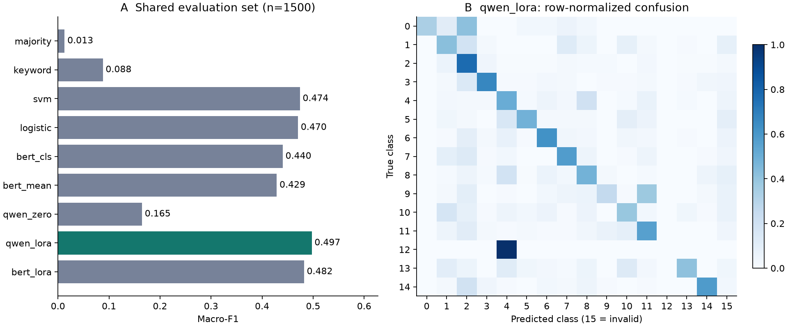

# 第六次作业 · 新闻分类方法对比

将课程的 Qwen3-0.6B 更换为 Qwen2.5-0.5B，在课程 TNEWS 15 类新闻标题数据上比较九种方法。主指标为 Macro-F1，同时报告 Accuracy、每类指标、混淆矩阵、解析失败数和预测分布。

## 数据和实验口径

原始课程训练集 53,360 条、验证集 10,000 条。先规范空白，训练集中同标题异标签的记录整组剔除，同标签重复仅保留一条。原始验证集剔除所有与原始训练集标题相同的记录，再去除内部重复。

从干净训练池分层抽取 7,000 条，划分为训练 6,000 条和调参 1,000 条。另从清洗后的课程验证集分层抽取最终评估 1,500 条。固定种子 42，保存了实际子集、原始样本 idx 和 SHA-256。所有学习方法共用这套划分。关键词只使用类别名称，未根据评估集编辑词表。字符级 TF-IDF 无需分词，使用 1–3 字符 n-gram。

课件第 12 页把教育映射到产业，而代码将其映射为噪音。本作业报告原始 15 类指标，所有方法使用相同的标签顺序。最终评估集用于比较各方法，选定的训练参数由调参集决定。只运行单一种子，结果限于这套子集。

## 方法和实测结果

| 方法 | Accuracy | Macro-F1 | 无效输出数 |
|---|---:|---:|---:|
| majority | 10.87% | 0.0131 | 0 |
| keyword | 13.67% | 0.0881 | 0 |
| svm | 49.40% | 0.4741 | 0 |
| logistic | 49.33% | 0.4704 | 0 |
| bert_cls | 46.20% | 0.4404 | 0 |
| bert_mean | 46.00% | 0.4288 | 0 |
| qwen_zero | 12.20% | 0.1647 | 1019 |
| qwen_lora | 52.33% | 0.4973 | 78 |
| bert_lora | 50.33% | 0.4822 | 0 |

本次最终评估中 Macro-F1 最高的是 **qwen_lora**。这反映的是固定数据规模下的表现。bert_cls/bert_mean 冻结 BERT 并训练逻辑回归，bert_lora 训练注意力 LoRA 和分类头。

- majority 预测训练集最多的类别。keyword 依次匹配类别名，未命中则退回多数类。
- svm/logistic 使用相同的字符 TF-IDF，最多 60,000 维，min_df=2。C 从 0.5、2、8 中按调参 Macro-F1 选择，使用 balanced 类别权重。
- bert_cls/bert_mean 使用 bert-base-chinese 冻结表示，最长 64 token，分别取首位置和排除 PAD 后的均值。分类头在训练集上标准化特征，C 从 0.1、1、10 中按调参 Macro-F1 选择，balanced 权重。Mean 包含 CLS/SEP。
- bert_lora 使用 Mean 池化，训练 BERT query/value 投影的 rank=8、alpha=16 LoRA 和线性分类头。3 轮，batch=32，AdamW 学习率 0.0002，weight_decay=0.01，训练集类别逆频率加权交叉熵，按调参 Macro-F1 保存最优权重后重新加载评估。
- qwen_zero 使用 Qwen2.5-0.5B 底座与固定分类模板。greedy 最多生成 8 token，输出中只有一个不歧义的类别名称时算解析成功，额外文本保留在 raw 字段。无效输出仍计入错误，并在 15 类 Macro-F1 的假阴性中体现。
- qwen_lora 与零样本使用同一底座、模板和解码。训练 Q/V 投影的 rank=8、alpha=16 LoRA，dropout=0.05，AdamW 学习率 0.0002、weight_decay=0.01。3 轮中按调参回答 NLL 保留最优 adapter，重新加载后评估。微批 8，累积至 32 条，只对类别名及结束标记计算交叉熵。



[已执行 Notebook](classification_report.ipynb) 展示方法对比、每类召回、预测分布、调参记录和错误例子。results 中保留所有方法在相同 1,500 条样本上的逐条预测。BERT 的时间字段含三套数据特征提取和分类头搜索，其他方法时间范围不同，不能作为端到端延迟对比。

## 运行

建议 Python 3.11。安装依赖后在 week06 下执行。CUDA 12.6 可先从 PyTorch 官方 cu126 索引安装 torch==2.7.1。

```powershell
python -m pip install -r requirements.txt
python predict.py --method svm --text "人工智能芯片研发取得新进展"
python predict.py --method qwen_lora --text "中国队赢得世界杯比赛"
python train.py --stage classical
python train.py --stage bert --bert google-bert/bert-base-chinese
python train.py --stage qwen --qwen Qwen/Qwen2.5-0.5B
```

train.py 默认使用随作业提供的固定子集。需要重新从课程原始数据抽样时传入 --source 原始code/data目录。BERT 与 Qwen 参数也接受本地模型目录。Qwen 固定版本为 060db6499f32faf8b98477b0a26969ef7d8b9987。默认基线推理使用本地训练好的 SVM，无需下载预训练模型。BERT 推理需约 412 MB 的预训练权重，Qwen 需约 988 MB 底座。提交附上四个传统分类器及 LoRA adapter，原始底座由运行环境准备。

Notebook 读取实测 JSON 并重新绘图，训练和逐条模型评估由 train.py 执行。跨设备、版本以及随机数会产生差异。课程仓库目标路径为 陈泽宇/week06/。

## 局限与分析

课程 TNEWS 是短标题粗粒度分类，财经与证券、文化与娱乐容易重叠。标题相同的泄漏已清理，语义近重复仍可能存在。稀少类别的 F1 方差较大，需同时查看支持样本数。Qwen 输出解析失败与类别判断错误分别保留在原始记录中。生成长度固定为 8，长度上限内未出现明确类别名的回答记为失败。

Qwen LoRA 比 SVM 的 Macro-F1 高约 2.32 个百分点，仍有 78/1500 条无效输出。证券类别只有 7 条最终评估样本，因此单类指标的波动较大。训练规模固定为 6,000 条，本结论适用于该预算下的比较。

## 独立推理检查

从磁盘加载交付权重，对「人工智能芯片研发取得新进展」分别调用 SVM、BERT LoRA 和 Qwen LoRA，三者都输出科技。Qwen 的 raw 字段在类别名后仍出现无关字符，说明该模型的停止与格式控制尚不稳定。本报告的类别指标允许唯一类别名周围存在额外文本，因此分数代表经过所述解析器后的分类表现。
