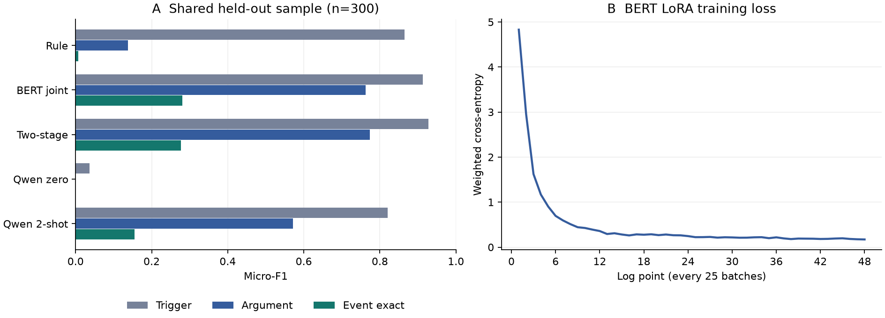

# 第七次作业 · 金融公告事件抽取

给定一条公告句段，抽取一个事件的类别、触发词和带角色的论元。本次保留课程 DuEE-Fin 派生数据，将课程的 Qwen3-0.6B 替换为 **Qwen2.5-0.5B-Instruct**，在同一评估集上比较五种方法。论元 F1 最高的方法是 **两段式（SVM 类型 → BERT）（0.7742）**。 [Qwen 模型卡](https://huggingface.co/Qwen/Qwen2.5-0.5B-Instruct)

## 数据与指标

课件 PDF 中的通用 DuEE 事件角色表用于理解任务。实际实验读课程 `code/data/processed/event_schema.json`，包含 DuEE-Fin 的 13 类金融事件及 92 个类型和角色组合。角色和偏移按原数据处理。输入通常是句段，并可能包含多句。

从 5,747 条原始抽取训练句段出发，按去除空白后的文本去重，再按原始文档 ID 固定切分。训练集 **5,151** 条，调参集 **568** 条。课程去重验证集经过训练原文档和文本检查后剩 920 条，从中按事件类型分层抽取 **300** 条作为统一评估集。训练、调参与评估无文档 ID 交集。种子为 42。样本 ID 和课程数据文件哈希见 [划分记录](results/splits.json)。

沿用老师提供的 `evaluate_events.py`。三级指标均为微平均 F1。触发词要求事件类型及触发词文本一致。论元要求事件类型、角色、论元文本一致。完整事件要求类型、触发词及全部论元一致。类型 Macro-F1 对各类等权。主分数按文本匹配，另校验每个预测 span 的字符偏移能切回原文。预测为空时仍计入分母。

## 对比结果

| 方法 | 触发词 F1 | 论元 P | 论元 R | 论元 F1 | 完整事件 F1 | 类型 Macro-F1 | ms/条 |
|---|---:|---:|---:|---:|---:|---:|---:|
| 词典＋正则 | 0.8648 | 0.1828 | 0.1106 | 0.1378 | 0.0067 | 0.8608 | 0.1 |
| BERT LoRA 联合抽取 | 0.9130 | 0.7208 | 0.8081 | 0.7620 | 0.2809 | 0.9244 | 4.4 |
| 两段式（SVM 类型 → BERT） | 0.9275 | 0.7350 | 0.8179 | 0.7742 | 0.2766 | 0.9524 | 4.7 |
| Qwen2.5 零样本 | 0.0366 | 0.0000 | 0.0000 | 0.0000 | 0.0000 | 0.1327 | 112.4 |
| Qwen2.5 检索两样本 | 0.8207 | 0.7271 | 0.4710 | 0.5717 | 0.1553 | 0.8173 | 310.2 |

- **词典＋正则**。从训练集统计至少出现两次的触发词，优先匹配长词，再按角色类型抽日期、金额、百分比、股份数和公司名。规则容易找到高频触发词，论元精确率和召回率受候选边界与角色分配限制。
- **BERT 联合抽取**。取 bert-base-chinese 前 8 层，训练注意力及前馈投影的 rank=12 LoRA 和线性头，共 1,441,685 个参数。用 tokenizer 的 offset mapping 对齐 BIO，最长 384 token，非 O 标签权重为 2。维特比只允许合法 BIO 路径。用调参论元 F1 选第 4 轮。RTX 4060 Laptop GPU 训练 4 轮耗时 209.9 秒（含调参集评估）。
- **两段式**。用训练集拟合字符 TF-IDF＋线性 SVM 判断类型，评估类型准确率 96.67%。复用同一 BERT 头，解码时只允许该类型的触发词及合法角色。相对联合抽取的论元 F1 变化为 **+1.22 个百分点**，先分类的错误会限制第二段的候选类型。这个对照衡量加类型门控的效果。两段式的论元 F1 更高，完整事件 F1 比联合抽取低 0.43 个百分点，说明更多论元命中并未带来更多整条完全匹配。
- **本地 Qwen**。两组共用模型、13 类 schema、greedy 解码、192 个新 token 上限及 JSON 校验。少样本从训练集按字符 TF-IDF 找两条相似示例，论元 F1 相对零样本变化 **+57.17 个百分点**。零样本有 199 条触发词无法定位到原文，例如输出了角色名「约谈机构」。加入示例后，这类错误减少到 23 条。可解析且保留事件的数量分别为 83 和 241，剩余状态与原始生成保存在各自的预测文件中。解析器校验类型、角色和原文子串，首次匹配回填偏移，额外或不合法论元按记录剔除。

表中耗时为本机批量评估的每条均值，模型已加载。BERT 与 Qwen 使用 GPU，规则使用 CPU。Qwen 少样本的表中时间从示例检索完成后开始，包含构建 prompt、生成及解析。数字适合比较本次批量实验的量级。



[已执行 Notebook](extraction_report.ipynb) · [十条错误案例](results/badcases.md) · [指标 CSV](results/comparison.csv) · [公告事件流输出](results/demo.json)

## 公告演示与局限

从公告原文按中文标点切句，逻辑回归检测有无事件，检测阈值 0.50 在内层调参集确定。清洗后的 4,815 条课程检测数据上检测 F1 为 **0.7748**。对通过检测的句段运行两段式抽取，再把字符偏移转换成公告全局位置。实跑前三篇课程公告，共输出 3 条去重事件。检测通过却没有触发词或论元时，在输出中标记复核。切句会拆开跨句论元，检测漏判也会让后续抽取漏掉事件。篇章级表现仅展示实际输出。

BIO 只能在同一 token 位置保留一个标签，重叠触发词和论元优先保留触发词。在这批样本上，384 token 上限截断了 1 条输入，1,629 个金标 span 均未越过截断边界。数字和英文子词仍可能带来边界偏差。LLM 的 JSON 校验保证保留下来的字面值出现在原文里，角色正确性仍由标注指标判断。单次 300 条评估覆盖 13 类，稀少类支持数较低。

## 项目经历摘要

用 5,151 条 DuEE-Fin 句段训练金融事件抽取器，在 300 条去重样本上统一比较 5 种方法。两段式达到论元 F1 0.7742，相比 BERT 联合抽取提高 1.22 个百分点，GPU 批量评估约 4.7 ms/条。实现公告切句、事件检测和原文偏移回填，保留逐条预测与错误分析。

## 运行与复现

建议 Python 3.11。本机环境为 PyTorch 2.7.1+cu126、Transformers 4.51.3。底座权重从模型仓库加载，也可传本地同版模型目录。BERT 检查点包含 LoRA 与分类头，依赖 bert-base-chinese。Qwen 使用官方固定 revision `7ae557604adf67be50417f59c2c2f167def9a775`。课程派生语料留在课程包内，复现时传入 `--data-dir`。如果 `week07` 位于课程目录里，数据路径自动指向同级 `code/data/processed`。

```powershell
python -m pip install -r requirements.txt

# 加载交付权重，抽取一个句段或一篇公告
python extract.py --text "甲公司公告称，公司以3000万元回购了120万股股份。"
python extract.py --file announcement.txt

# 在单独的输出目录复跑全部实验
python train.py --data-dir "../code/data/processed" --output runs/repro
python llm.py --data-dir "../code/data/processed" --output runs/repro
python analyze.py --data-dir "../code/data/processed" --output runs/repro
python extract.py --demo --data-dir "../code/data/processed" --artifacts runs/repro --out runs/repro/results/demo.json
```

Notebook 读取实测结果并重绘图表，训练、生成与复算由上述脚本执行。课程仓库目标路径为 `陈泽宇/week07/`。
