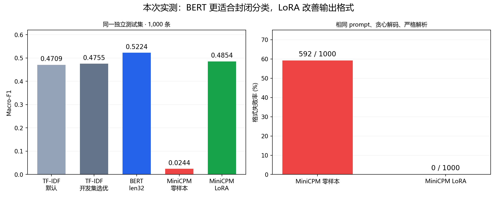

# week06：中文新闻分类实验结果

陶欣荣 · 第六周作业

在 63,360 条原始中文新闻上完成去重与冲突审计，使用 5,000 条训练样本，对比规则、TF-IDF、BERT 微调、MiniCPM4-0.5B zero-shot 和 LoRA SFT。开发、校准、阈值选择、测试集合各 1,000 条，互不重叠；本次实验为单 seed。

开发集选定的 BERT（max_length=32）在测试集上的 Macro-F1 为 **0.5224**，比默认 TF-IDF 高 **5.15 个百分点**；A10 单条推理 P50 **5.24 ms**。阈值分流后自动推送 316 条，误推率 **7.59%（24/316）**，覆盖率 **31.6%（316/1000）**。

## 阅读入口

- [实战任务提交文字](实战任务_最终版.md)：数据规模、基线对比、性能与成本口径。
- [实验结论与复盘](实验结论与复盘.md)：路线比较、消融实验、校准与错误分析。
- [完整统计报告](实验报告.md)：9 组实测结果、6 组 TF-IDF 调参与评测三问。
- [逐类指标](per_class.csv)、[混淆矩阵](confusion.png)、[错误案例](errors.csv)、[零样本格式失败](zero_shot_failures.csv)。
- [机器可读指标](metrics_summary.json)、[TF-IDF 调参结果](tfidf_tuning.json)、[已执行的审计结果](审计结果.json)。

## 结果边界

- 所有方法使用同一 1,000 条测试样本；零样本的 592 条解析失败均计入分母。
- 类别映射构成投研代理任务，尚未验证真实业务相关性。
- 误推率的 95% Wilson 上界为 11.05%，不能据此承诺生产误推率低于 10%。
- CPU 与 GPU 耗时分别标注；各路线训练计时边界见报告。
- 云端完整流程约 30.10 分钟，使用 ModelScope 免费 A10 额度。

本目录只提交实验结果，不包含训练源码、原始数据、模型权重或运行环境。metrics_summary.json 保留原始结果的指标与实验元数据，省略逐条预测和环境信息。报告里的脚本名是完整实验包的来源说明，不表示本目录附带脚本。审计文件记录此前对 9 组共 9,000 条预测的核验，本目录本身不提供完整重跑条件。
