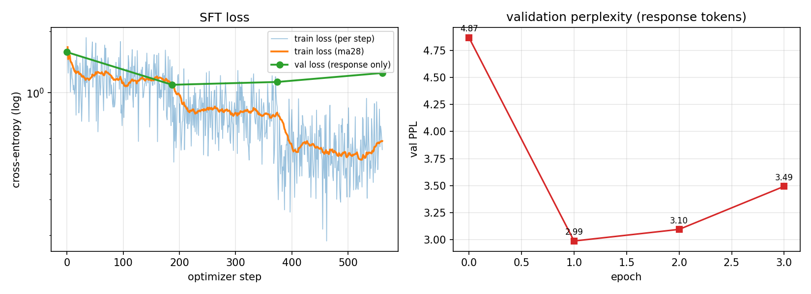

# Week05 作业：基于语言模型的 SFT 训练

## 作业要求

第五周从 BERT 讲到 LLM：预训练只让模型学会「接龙」，要把它变成「问答助手」，中间还差一个
**SFT（Supervised Fine-Tuning，指令微调）**。

本周作业：**尝试进行基于语言模型的 SFT 训练**。用课程给的 3000 条 `(instruction, output)`
数据，对一个开源语言模型做一次完整的 SFT，并验证它是否真的从「续写器」变成了「按指令回答的助手」。

## 结论先说

基座是 **Qwen2-0.5B**（纯预训练，不是 Instruct），LoRA 只训 **1.78%** 的参数，
单张 RTX 4060 Ti 16GB 上 **8.9 分钟**跑完 3 个 epoch。在 200 条从未见过的验证集上：

| 指标 | SFT 前 | SFT 后 |
|---|---|---|
| 验证 loss（只在回答段） | 1.583 | **1.095** |
| 验证 PPL | 4.87 | **2.99** |
| 字符级 ROUGE-L | 0.228 | **0.562** |
| 数字答案完全匹配 | 12.1% | **36.2%** |
| 平均回答长度 | 107 字 | **23 字**（参考答案 27 字） |
| 生成 im_end 停止 | 44% | **99%** |
| 复述问题的比例 | 11.5% | **1.5%** |

**SFT 确实把「回答的形式」学会了**：答案变短、贴参考答案、说完会停。
但算术题大量算错（见 3.3）——这也正好印证课上的那句话：
**知识来自预训练，形式来自 SFT**，SFT 教不会模型它本来就不会的算术。

---

## 1. SFT 到底改了什么

### 1.1 目标函数没变，变的是数据和 loss 落点

预训练和 SFT 都是 next-token prediction，模型结构一个新层都没加。区别只有两个：

1. **数据换成 chat 格式的 (指令, 回答)**；
2. **loss 只算在「回答」那一段**（Loss Mask），提问段不参与梯度。

### 1.2 Chat 模板

Qwen2 用的是 ChatML。一条样本会被拼成：

```text
<|im_start|>system
You are a helpful assistant<|im_end|>
<|im_start|>user
给定两个数字，请选择其中的较大数并将其打印出来。 数字1: 238 数字2: 564<|im_end|>
<|im_start|>assistant
较大的数字是 564。<|im_end|>
```

代码上就是 tokenizer 自带的 `apply_chat_template`：

```python
messages = [
    {"role": "user", "content": ex["instruction"]},
    {"role": "assistant", "content": ex["output"]},
]
full_text = tok.apply_chat_template(messages, tokenize=False)
prompt_text = tok.apply_chat_template(messages[:-1], tokenize=False,
                                      add_generation_prompt=True)
```

### 1.3 Loss Mask

把 prompt 段（system + user + `<|im_start|>assistant`）的 label 全部设成 `-100`，
回答段保留真实 token id：

```python
full_ids   = tok(full_text, add_special_tokens=False)["input_ids"]
prompt_ids = tok(prompt_text, add_special_tokens=False)["input_ids"]
assert full_ids[:len(prompt_ids)] == prompt_ids      # 必须严格是前缀

labels = [-100] * len(prompt_ids) + full_ids[len(prompt_ids):]
loss   = F.cross_entropy(logits, labels, ignore_index=-100)
```

`outputs/lora_r16/example_encoding.txt` 里把实际编码打出来了，前 49 个 token 的
label 全是 `-100`，从「较大的」开始才是真实 id：

```text
   '<|im_start|>' label=-100
   'user'         label=-100
   '给'           label=-100
   ...
   'assistant'    label=-100
   '\n'           label=-100
>> '较大的'        label=107771
>> '数字'          label=82587
>> '是'            label=20412
>> ' '             label=220
>> '5'             label=20
>> '6'             label=21
>> '4'             label=19
>> '。'            label=1773
>> '<|im_end|>'    label=151645
```

> 注意：`-100` 是 PyTorch 的 `ignore_index` 约定，不能填 0（0 是真实 token「!」，
> 会被当成监督信号）。

### 1.4 LoRA

0.5B 全参数 SFT 在 16GB 卡上理论上放得下，但权重 1GB、优化器状态更大，而且作业仓库不适合放
1GB 的 checkpoint，所以默认用 LoRA（`--no-lora` 保留全参数路径，本作业只做了 8 条样本的冒烟测试，
没有跑完整的全参数训练）：

```python
LoraConfig(r=16, lora_alpha=32, lora_dropout=0.05,
           target_modules=["q_proj","k_proj","v_proj","o_proj",
                           "gate_proj","up_proj","down_proj"],
           task_type="CAUSAL_LM")
```

| | 数值 |
|---|---|
| 基座总参数 | 494,032,768 |
| LoRA 可训练参数 | **8,798,208（1.78%）** |
| 保存下来的 adapter | 35 MB |

`--no-lora` 可以切换到全参数微调，代码走同一条训练路径。

---

## 2. 实验设置

| 项目 | 值 |
|---|---|
| 基座 | `Qwen2-0.5B`（预训练版，非 Instruct） |
| 训练数据 | `data/sft_train.jsonl`，3000 条 |
| 验证数据 | `data/sft_val.jsonl`，200 条（未参与训练） |
| 数据长度 | 训练集平均 62.7 token/条；prompt 41.1，回答 21.6，**回答只占 34.4%** |
| 词表 | 151,646 |
| 序列长度 | `max_len=512`（实际最长 111，无截断） |
| 微调方式 | LoRA r=16，α=32，dropout 0.05，全部 7 个线性层 |
| batch | 8 × 梯度累积 2 = 有效 batch 16 |
| 优化器 | AdamW，lr 2e-4，weight_decay 0，cosine + 3% warmup，梯度裁剪 1.0 |
| 精度 | bf16（autocast） |
| epoch | 3（共 561 个 optimizer step） |
| 硬件 | i5-12400F + RTX 4060 Ti 16GB |
| 耗时 | **534.7 秒**（约 8.9 分钟，约 0.95 秒/step） |

> 为什么不用 `Qwen2-0.5B-Instruct`：它已经做过 SFT 和对齐，拿它当起点看不出 SFT 到底改了什么。
> 用纯预训练权重，前后对比才是「续写 → 问答」的真实变化。

---

## 3. 结果

### 3.1 训练过程

| epoch | train loss | val loss | val PPL | 下一 token 准确率 |
|---|---|---|---|---|
| 0（base） | — | 1.5826 | 4.87 | 65.46% |
| 1 | 1.1849 | **1.0949** | **2.99** | 72.02% |
| 2 | 0.8050 | 1.1302 | 3.10 | 72.48% |
| 3 | 0.5352 | 1.2510 | 3.49 | 72.17% |



**第 1 个 epoch 之后就开始过拟合**：train loss 一路降到 0.54，val loss 反而从 1.09 涨回 1.25。
3000 条数据、1.78% 的参数，1 个 epoch 已经把这些模板学完了，再训就是在背训练集。
所以最终提交的是 **epoch 1 的 checkpoint**（脚本按 val loss 自动保存 best）。
这也对应课上说的「SFT 小学习率、少 epoch，训久了会丢预训练能力」。

### 3.2 base vs SFT：全指标

| 指标 | base | SFT | 变化 |
|---|---|---|---|
| 验证 loss（只在回答段） | 1.5830 | **1.0951** | −0.488 |
| 验证 PPL | 4.87 | **2.99** | −1.88 |
| 下一 token 准确率 | 65.60% | **72.13%** | +6.5 pt |
| prompt 段 CE（提问） | 2.6050 | 3.7100 | **+1.105** |
| response 段 CE（回答） | 1.5830 | **1.0951** | −0.488 |
| 完全匹配率 | 0.00% | **3.00%** | +3 pt |
| 字符级 ROUGE-L | 0.2279 | **0.5619** | +0.334 |
| 数字答案匹配率 | 12.07% | **36.21%** | +24 pt |
| 平均回答长度（字） | 107.3 | **23.0** | 参考答案 27.1 |
| 平均生成长度（token） | 50.7 | **17.8** | — |
| im_end 停止率 | 44.00% | **99.00%** | +55 pt |
| 复述问题比例 | 11.50% | **1.50%** | −10 pt |

逐条看：**200 条里 ROUGE-L 变好 178 条、变差 22 条**；数字题完全匹配从 21 条涨到 63 条。

> 指标定义：生成用 greedy decoding（`do_sample=False`），最多 64 个新 token；
> ROUGE-L 是字符级 LCS F1；「数字答案匹配」指从回答里抽出的数字集合与参考答案完全一致；
> 「复述问题」指输出里出现了指令的前 12 个字。

**prompt 段 CE 从 2.61 涨到 3.71**，这一点值得单独说：SFT 只在回答段算 loss，
模型把参数预算全花在「怎么答」上，对「提问文本本身」的建模反而变差了。
但这不代表模型「看不懂问题」——下面 3.3 的回答都和问题相关，只是提问的 token 概率分布被挪走了。
这也说明 **prompt CE 不是「理解能力」的度量**。

### 3.3 生成样例：形式学会了，算术没学会

| 指令 | 参考答案 | SFT 前 | SFT 后 |
|---|---|---|---|
| 为我推荐一款适合初学者的编程语言。 | Python 是一款适合初学者的编程语言。 | 根据您提供的信息，我推荐 Python……（100+ 字） | **Python 是一种适合初学者的编程语言。** |
| 给定两个数字，求他们的乘积。数字1: 5，数字2: 8 | 这两个数字的乘积是 40。 | 根据题目描述，数字1是5……即 5 乘以 8 等于 40。（绕圈子） | **数字1和数字2的乘积是 40。** |
| 给定电影名，预测电影票房收入。辛德勒的名单 | 无法精确预测，但《辛德勒的名单》…… | 重复「根据提供的电影名辛德勒的名单，预测电影票房收入。」×N，停不下来 | **辛德勒的名单的票房收入取决于电影的类型和发行时间。**（会停了） |
| 计算 13 和 37 的平均数，保留两位小数 | 25.00 | 用英文推导 13+37，最后没给结果 | **这两个数的平均数为 30。**（形式对，**算错**） |
| 计算 28.6 ÷ 2.1 | 13.6 | 14.2 | **14.**（形式对，**算错**） |
| 日期差：2021-01-01 到 2022-02-02 | 398 天 | 写公式，没算完 | **31 天**（形式对，**算错**） |

前三行是 SFT 的典型收益：**变短、贴格式、会停**。
后三行是典型失败：**句子像模像样，数字是错的**。0.5B 模型本身算术就弱，SFT 的 3000 条数据
也不是用来「灌知识」的——它只学会了「答案应该长成 `这两个数的平均数为 X。` 这样」。

> 这也解释了为什么数字匹配率只有 36%：格式对了，抽取数字就能对上；但只要算错，就还是 0 分。

### 3.4 消融：Loss Mask 到底有没有用

用**完全相同的配置**（1 epoch、lr 2e-4、batch 8×2、LoRA r=16）再训一版，
唯一区别是 `--no-mask`：prompt 段也参与 loss。

| 指标 | base | SFT（mask） | SFT（不 mask） |
|---|---|---|---|
| 验证 loss（回答段） | 1.5830 | **1.0949** | 1.1119 |
| response 段 CE | 1.5830 | **1.0951** | 1.1118 |
| prompt 段 CE | 2.6050 | 3.7100 | **0.9976** |
| 字符级 ROUGE-L | 0.2279 | **0.5619** | 0.5562 |
| 数字答案匹配率 | 12.07% | **36.21%** | 35.06% |
| 平均回答长度（字） | 107.3 | 23.0 | 24.3 |
| im_end 停止率 | 44.00% | **99.00%** | 98.00% |

（消融版只跑了 1 个 epoch，和主实验的 best epoch 1 对齐；学习率按 1 个 epoch 的 cosine 走完，
主实验的第 1 个 epoch 结束时 lr 还剩 1.5e-4，这一点两者略有差异。）

结论有点反直觉：**在这个数据集上，遮不遮 prompt 对生成质量影响很小**——
ROUGE-L 0.562 vs 0.556，数字匹配 36.2% vs 35.1%，回答长度也差不多。
真正的差别在 prompt 段 CE：**3.71 vs 1.00，差了近 4 倍**。

不遮 prompt 时，模型把容量花在「把提问也预测准」上：验证集 prompt 的 CE 被压到 1.00，
但回答段的 CE 反而略高（1.112 vs 1.095）。也就是说，梯度预算被 prompt 分走了一部分，
回答没学得更好，只是多学会了一件「本不该由它生成」的事——续写用户的问题。

为什么生成指标差距不大：这套数据的 prompt 高度模板化（「给定两个数字…… 数字1: X 数字2: Y」），
回答又短（只占 34% token），回答段的 loss 本来就是大头；当 prompt 更长、任务更多样时，
不遮 prompt 的代价会放大。所以 mask 的意义不是「立刻涨点」，而是**把有限的参数和梯度只花在
「该怎么答」上**——课上那句「只学怎么答，不背问什么」，在 prompt CE 这一列看得最清楚。

---

## 4. 怎么理解这些结果

### 4.1 知识 vs 形式

- **形式（SFT 能给的）**：回答长度、开头句式、分点、结束符、语言（不再中英混杂）——全部学会。
- **知识（SFT 给不了的）**：13 和 37 的平均数、28.6÷2.1、日期差——该错还是错。
  这些要靠预训练语料里的世界知识和更强的基座模型，几万条指令数据灌不进去。

### 4.2 过拟合与分布漂移

- response CE 降、prompt CE 升，是「loss 只落在回答段」的直接结果：模型的 token 概率质量被挪到
  「怎么答」上，不等于它看不懂问题（3.4 的 no-mask 对照更直观：不遮 prompt 时 prompt CE 会被压到 1.0）。
- 第 2、3 个 epoch train loss 继续掉、val loss 回升，是标准过拟合。
- 课上讲的**灾难性遗忘**（通用知识退化）这次没有系统测——只做了指令任务的前后对比，没有跑通用评测集。
  能做的规避是「1 epoch + LoRA 1.78% + 小学习率 + 保存 best」，这也是本次采用的全部策略。
  要量化遗忘，需要再拿一组通用任务（比如常识问答、开放写作）跑 base vs SFT，这是本作业的局限。

### 4.3 LoRA 的性价比

8.8M 可训练参数（1.78%）把 val loss 从 1.58 拉到 1.09，adapter 只有 35MB，
换模型、换任务只要换一个 adapter。对「一个基座 + 多个业务风格」的场景，这是最实用的方案。

---

## 5. 运行方式

环境：Python 3.12 + torch 2.13 + transformers 5.15 + peft 0.20（`requirements.txt`）。

```powershell
# 0) 准备基座（任选一种；仓库里不放 1GB 权重）
#    huggingface-cli download Qwen/Qwen2-0.5B --local-dir D:\models\Qwen2-0.5B
#    或从 ModelScope 下载

# 1) 训练（默认 LoRA，3 epoch，约 9 分钟）
python sft_train.py --model D:\models\Qwen2-0.5B

# 2) 评估 base
python sft_eval.py --model D:\models\Qwen2-0.5B --label base

# 3) 评估 SFT
python sft_eval.py --model D:\models\Qwen2-0.5B --adapter outputs\lora_r16\best --label sft

# 4) 汇总成表格
python compare.py

# 5) 单条对比 / 交互
python infer.py --adapter outputs\lora_r16\best --prompt "给定两个数字，请选择其中的较大数并将其打印出来。 数字1: 238 数字2: 564"

# 可选：全参数微调 / 不遮 prompt 的消融
python sft_train.py --model D:\models\Qwen2-0.5B --no-lora --lr 2e-5
python sft_train.py --model D:\models\Qwen2-0.5B --no-mask --epochs 1 --output outputs\ablation_nomask
```

> `outputs/lora_r16/best/adapter_config.json` 里记录的基座路径是本机的
> `D:\Env\models\Qwen2-0.5B`。换机器时给 `infer.py` / `sft_eval.py` 显式传 `--model` 即可覆盖。

---

## 6. 踩到的坑

1. **batch 32 会把 16GB 显存打满**。第一次跑 batch=32，显存占到 15.8GB（桌面还开着浏览器、微信等），
   step 1 之后两分钟没有 step 20，进程 Working Set 11.7GB，明显在往共享内存里换页。
   改成 batch 8 + 梯度累积 2 后稳定在 0.95 秒/step。
2. **transformers 5.x 的 `apply_chat_template` 返回的不是 Tensor**。默认 `return_dict=True` 时返回
   `BatchEncoding`（要取 `["input_ids"]`）；`return_dict=False` 但没给 `return_tensors` 时返回 list。
   第一次直接 `.unsqueeze(0)` 报了 `'list' object has no attribute 'unsqueeze'`。
3. **HF 直连超时**，模型是从 ModelScope 的 repo API 下载的；HF 的 `hf-mirror` 当时只有 0.3MB/s，
   ModelScope 能到 20MB/s。
4. **Qwen 把数字拆成单 token**（`564` → `5` `6` `4`），所以算术题是在 token 级别硬拟合，
   0.5B 模型算错很正常；评估时用「数字集合匹配」比 token 级 loss 更能看出真实水平。
5. **3 个 epoch 里 best 是 epoch 1**。train loss 从 1.18 降到 0.54，val loss 从 1.09 涨回 1.25，
   后两个 epoch 纯属给过拟合交学费；`--epochs 1` 能省 2/3 时间，效果一样。
6. **OpenMP 运行库冲突**：Anaconda 环境里 torch 和 matplotlib 同时加载容易撞车（第四周踩过），
   脚本开头统一加 `os.environ["KMP_DUPLICATE_LIB_OK"]="TRUE"`，且放在 import 之前。
7. **prompt CE 升高不是 bug**。2.61→3.71 很容易被误认为 mask 写反了，但 no-mask 对照证明这正是
   「只学回答」的代价；判断 mask 对不对要看「回答段 loss 是否下降」和 `example_encoding.txt`
   里的 label，而不是 prompt CE。

---

## 附：文件说明

| 文件 | 说明 |
|---|---|
| `sft_train.py` | SFT 主脚本：chat 模板、loss mask、LoRA/全参数、训练+验证+保存 best |
| `sft_eval.py` | 评估：response loss/PPL、生成、ROUGE-L、数字匹配、prompt/response 分段 CE |
| `compare.py` | 把多次评估汇总成 markdown 对比表 |
| `infer.py` | 单条/交互推理，同时输出微调前/后（disable/enable adapter） |
| `data/sft_train.jsonl` | 课程数据，3000 条 |
| `data/sft_val.jsonl` | 课程验证集，200 条 |
| `outputs/lora_r16/best/` | 最优 LoRA adapter（35MB） |
| `outputs/lora_r16/metrics.json` | 每 epoch 的 loss/PPL/准确率 + 完整超参 |
| `outputs/lora_r16/loss_curve.png` | 训练曲线 |
| `outputs/lora_r16/example_encoding.txt` | 实际 token / label 编码，验证 mask 是否正确 |
| `outputs/eval_base.json` / `eval_sft.json` | 200 条验证集的逐条预测与指标 |
| `outputs/eval_compare.md` | base vs SFT 的对比报告 |
