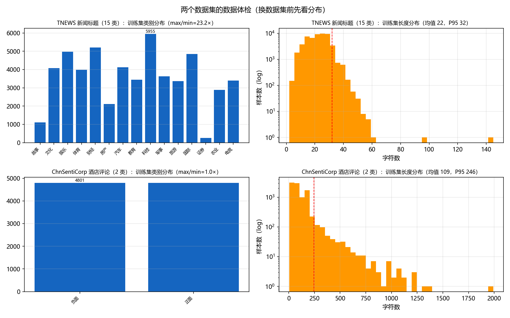
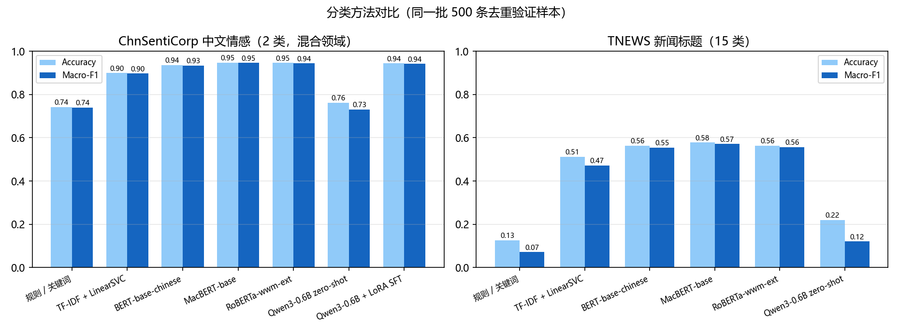
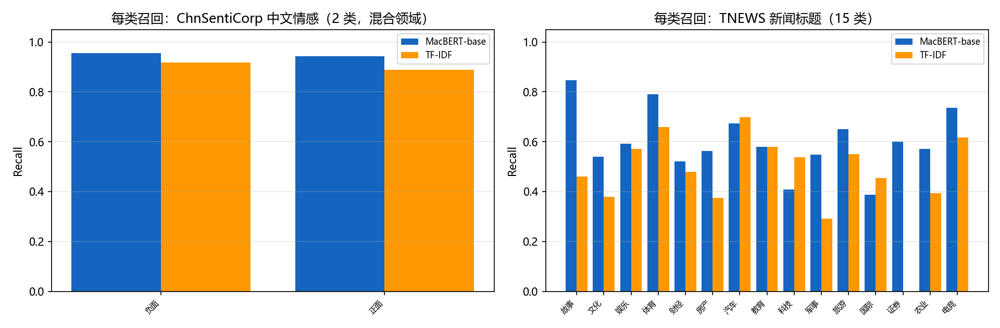
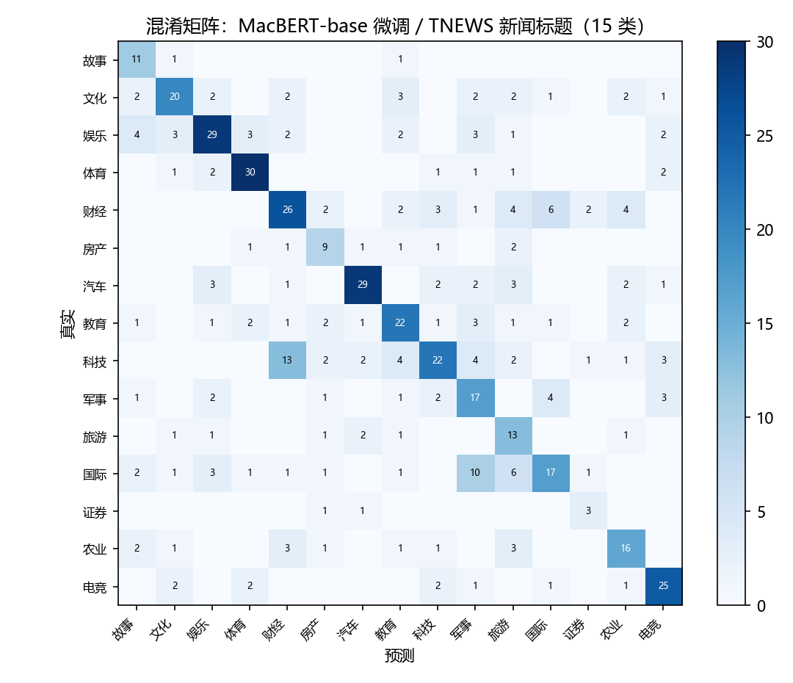
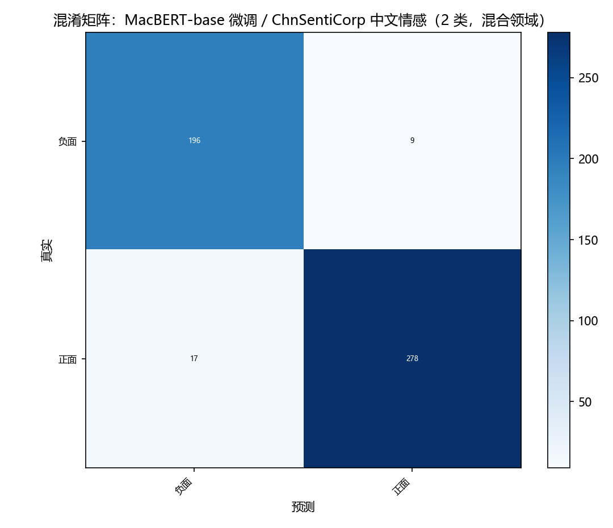
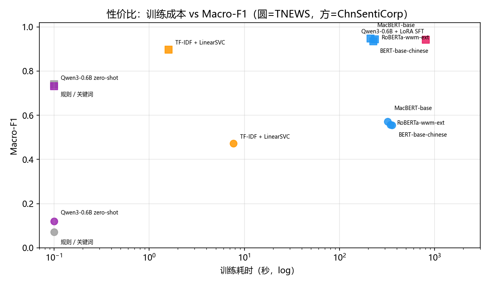

# Week06 作业：换预训练模型 / 换数据集，分类方法对比

## 0. 一句话结论

在课程 TNEWS 15 类新闻分类的骨架上，我做了两个维度的对照实验：

1. **换预训练模型**：固定数据与全部超参，把 `bert-base-chinese` 换成同尺寸的
   `RoBERTa-wwm-ext`、`MacBERT-base`，再加规则、TF-IDF、Qwen3-0.6B zero-shot 作为非微调基线；
2. **换数据集**：把同一套协议原样搬到 `ChnSentiCorp` 中文情感二分类（2 类、均衡、长文本、混合领域），
   看方法排序会不会变。

结论：**同尺寸换预训练模型只值 1 个点上下（bootstrap 后大多不显著）；
换数据集带来的差异远大于换模型**——15 类短文本上 BERT 领先 TF-IDF 约 8 个点，
2 类均衡长文本上差距缩到 3.6 个点（0.898 vs 0.934），而训练成本差 100 倍以上。
**先看清楚数据（类别数、均衡度、文本长度、泄漏），再决定要不要上预训练模型。**

---

## 1. 作业要求与实验设计

### 1.1 题目拆解

作业题目是「更换预训练模型或数据集，做分类任务各种方法的对比实验」。我把「或」拆成两个独立对照维度，
并保证两维都能单独回答一个问题：

| 维度 | 固定什么 | 变什么 | 回答的问题 |
|---|---|---|---|
| A 换模型 | 数据、切分、超参、评测样本 | BERT / RoBERTa / MacBERT / TF-IDF / 规则 / zero-shot | 同尺寸换预训练模型，到底能涨多少？ |
| B 换数据集 | 方法实现、超参、评测协议 | TNEWS 15 类 ↔ ChnSentiCorp 2 类 | 方法排序会随数据集变化吗？ |

### 1.2 统一评测协议

所有方法必须跑在**同一批样本**上，否则「差 2 个点」可能只是抽样波动：

- **去重**：验证集里与训练集句子完全相同的样本先剔除。
  TNEWS 剔除 1,099/10,000（11.0%），ChnSentiCorp 剔除 338/1,200（**28.2%**）。
- **抽样**：从干净验证集里 `seed=42` 抽 500 条，所有方法共用。
- **主指标**：Macro-F1（15 类长尾下比 Accuracy 更敏感）；Accuracy 统一「解析失败算答错」。
- **辅助**：per-class recall、混淆矩阵、ECE、预测覆盖类别数、训练/推理成本。
- **生成式方法**（zero-shot / LoRA）解析失败的样本记为 -1，**仍计入 Accuracy 分母**，
  不允许靠丢样本虚高。

### 1.3 两个数据集

| | TNEWS | ChnSentiCorp |
|---|---|---|
| 任务 | 中文新闻标题 15 类 | 中文评论情感 2 类 |
| 训练 / 验证 | 53,360 / 10,000 | 9,600 / 1,200 |
| 去重后可评测 | 8,901 | **862** |
| 类别分布 | 最大类 11.2%、最小类 0.5%（**23×**） | 负面 4,801 / 正面 4,799（**1.0×**） |
| 文本长度 | 均值 22 字，P95 32 字 | 均值 109 字，P95 246 字 |
| 领域 | 新闻标题（短、信息密度高） | 酒店/书评/数码混合评论（长、主观） |



> ChnSentiCorp 来自 [lansinuote/ChnSentiCorp](https://hf-mirror.com/datasets/lansinuote/ChnSentiCorp)，
> 官方标签为 negative(0) / positive(1)。抽样检查发现它并不是纯酒店评论：
> 约 29% 提到酒店/房间、28% 提到书、10% 提到电脑/数码。

### 1.4 方法清单

| 方法 | 层级 | 是否训练 | 说明 |
|---|---|---|---|
| 规则 / 关键词 | L0 | 否 | TNEWS：类别名匹配；情感：情感词典打分；未命中退多数类 |
| TF-IDF + LinearSVC | L1 | 是（秒级） | 字符 1-2gram，30 万特征 |
| BERT-base-chinese 微调 | L2 | 是 | 课程基线骨干 |
| RoBERTa-wwm-ext 微调 | L2 | 是 | 全词掩码、去 NSP、更多语料 |
| MacBERT-base 微调 | L2 | 是 | 纠错式掩码（MLM as correction） |
| Qwen3-0.6B zero-shot | L3 | 否 | 给类别清单，直接生成标签 |
| Qwen3-0.6B + LoRA SFT | L4 | 是 | 生成式微调（仅 ChnSentiCorp） |

三个编码器都是 **12 层 / 768 维 / 102.3M 参数**，训练超参完全一致：
cls 池化、类别加权、分层学习率（2e-5 / 头 ×5）、warmup 10%、3 epoch、seed=42。
所以 A 维度是严格的「只换预训练权重」控制变量实验。

---

## 2. 结果

### 2.1 TNEWS（15 类新闻标题）

| 方法 | 参数 | Acc（含失败） | Macro-F1 | 覆盖类别 | 训练耗时 | 推理 ms/条（批量） |
|---|---|---|---|---|---|---|
| 规则 / 关键词 | — | 0.126 | 0.0716 | 10/15 | 0s | — |
| TF-IDF + LinearSVC | — | 0.512 | 0.4721 | 15/15 | 8s | <0.1 |
| BERT-base-chinese | 102.3M | 0.564 | 0.5547 | 15/15 | 5.9min | 0.5 |
| RoBERTa-wwm-ext | 102.3M | 0.564 | 0.5574 | 15/15 | 5.7min | 0.5 |
| **MacBERT-base** | 102.3M | **0.578** | **0.5710** | 15/15 | 5.3min | 0.5 |
| Qwen3-0.6B zero-shot | 596M | 0.220 | 0.1209 | 9/15 | 0 | 10.6 |

- 规则法命中率只有 6.6%，Macro-F1 0.072，基本等于随机（1/15=0.067）——标题里很少直接写类别名。
- **和课程基线对得上**：TF-IDF 0.472（课程 0.472）、BERT 0.555（课程 0.556），说明数据切分与评测口径复现正确；
  在这个可信的基线上再换模型/换数据集，数字才有意义。
- TF-IDF 0.472 是「不引入预训练」的真实基线；三个微调模型比它高 **8~10 个点**。
- 三个 BERT 家族内部：MacBERT 最好（0.571），RoBERTa（0.557）和 BERT（0.555）几乎一样。
- zero-shot 只覆盖 9/15 类，280/500 判成「文化」（预测塌缩）。

### 2.2 ChnSentiCorp（2 类中文评论情感）

| 方法 | 参数 | Acc（含失败） | Macro-F1 | 覆盖类别 | 训练耗时 | 推理 ms/条（批量） |
|---|---|---|---|---|---|---|
| 规则 / 情感词典 | — | 0.742 | 0.7397 | 2/2 | 0s | — |
| TF-IDF + LinearSVC | — | 0.900 | 0.8978 | 2/2 | 2s | <0.1 |
| BERT-base-chinese | 102.3M | 0.936 | 0.9343 | 2/2 | 3.8min | 2.0 |
| RoBERTa-wwm-ext | 102.3M | 0.946 | 0.9445 | 2/2 | 3.9min | 1.9 |
| **MacBERT-base** | 102.3M | **0.948** | **0.9466** | 2/2 | 3.5min | 1.8 |
| Qwen3-0.6B zero-shot | 596M | 0.762 | 0.7313 | 2/2 | 0 | 44.6 |
| Qwen3-0.6B + LoRA SFT | 601M（训 5.05M） | 0.944 | 0.9424 | 2/2 | 13.5min | 37.2 |

- 情感词典（正/负词表）就能到 0.740，**比 0.6B zero-shot（0.731）还高**——这个任务的字面信号太强。
- TF-IDF 0.898，已经接近「简单模型」的天花板；三个 BERT 在 0.934~0.947 之间，只多 3.6~4.9 个点。
- 和 TNEWS 对比：同一个 TF-IDF 实现，在 15 类短标题上落后 BERT 8.3 个点，在 2 类评论上只落后 3.6 个点。
- Qwen3 + LoRA SFT 把 zero-shot 的 0.731 拉到 **0.942**，追平 BERT（0.934），只比 MacBERT 低 0.4 点。



### 2.3 维度 A：换预训练模型，到底涨了多少？



| 数据集 | BERT | RoBERTa | MacBERT | RoBERTa−BERT | MacBERT−BERT | 结论 |
|---|---|---|---|---|---|---|
| TNEWS | 0.5547 | 0.5574 | 0.5710 | +0.0027 | +0.0163 | 都不显著 |
| ChnSentiCorp | 0.9343 | 0.9445 | 0.9466 | +0.0102 | +0.0123 | 都不显著 |

**配对 bootstrap（2000 次重采样，500 条样本）**：

| 数据集 | 对比 | 差值 | 95% CI | 结论 |
|---|---|---|---|---|
| TNEWS | RoBERTa − BERT | +0.002 | [−0.033, +0.038] | 不显著 |
| TNEWS | MacBERT − BERT | +0.016 | [−0.018, +0.051] | 不显著 |
| TNEWS | TF-IDF − BERT | −0.082 | [−0.129, −0.032] | **显著** |
| TNEWS | MacBERT − TF-IDF | +0.097 | [+0.048, +0.149] | **显著** |
| ChnSentiCorp | RoBERTa − BERT | +0.010 | [−0.008, +0.027] | 不显著 |
| ChnSentiCorp | MacBERT − BERT | +0.012 | [−0.004, +0.029] | 不显著 |
| ChnSentiCorp | LoRA SFT − BERT | +0.008 | [−0.011, +0.028] | 不显著 |
| ChnSentiCorp | TF-IDF − BERT | −0.037 | [−0.064, −0.012] | **显著** |
| ChnSentiCorp | MacBERT − TF-IDF | +0.049 | [+0.026, +0.073] | **显著** |

> 完整结果见 [results/significance.md](results/significance.md)。

**结论**：换同尺寸预训练模型（BERT → RoBERTa / MacBERT）在两个数据集上都只有 **0.3~1.6 个点**的提升，
bootstrap 后**全部不显著**。把 MacBERT 换回 BERT 省下的时间，比换模型带来的收益更确定。

### 2.4 维度 B：换数据集，方法排序变了吗？

| 方法族（取最好） | TNEWS Macro-F1 | ChnSentiCorp Macro-F1 | 变化 |
|---|---|---|---|
| 规则 | 0.072 | 0.740 | +0.668 |
| TF-IDF | 0.472 | 0.898 | +0.426 |
| 预训练编码器 | 0.571 | 0.947 | +0.376 |
| LLM zero-shot | 0.121 | 0.731 | +0.610 |

绝对分数不能跨任务直接比（类别数不同，随机基线就不同），真正要看的是**方法之间的差距**：

| 对照 | TNEWS（15 类） | ChnSentiCorp（2 类） | 变化 |
|---|---|---|---|
| BERT − TF-IDF | +8.3 pt | +3.6 pt | 差距缩小 4.7 pt |
| MacBERT − TF-IDF | +9.9 pt | +4.9 pt | 差距缩小 5.0 pt |
| zero-shot − 规则 | +4.9 pt | −0.8 pt | 规则反超 |
| TF-IDF 训练耗时 | 8 s | 2 s | — |
| BERT 训练耗时 | 5.9 min | 3.8 min | — |

- **15 类短标题**：标签抽象、类别多、长尾 23×，TF-IDF 对「证券/军事」这类没有字面线索的类几乎无能为力
  （证券 recall = **0.00**，军事 0.29）；预训练知识在这里值 8~10 个点。
- **2 类均衡评论**：字面情感词（好/差/满意/失望）已经足够，TF-IDF 到 0.898；
  预训练编码器的优势缩到 3~5 个点，但仍**显著**（不是「追平」）。
- **zero-shot**：2 类任务上 0.731，已经可用作冷启动；15 类任务上 0.121，完全不可用（只覆盖 9 类）。
- **规则**：在 2 类情感上 0.740，反超 0.6B zero-shot；在 15 类新闻上 0.072，等于随机。
  规则能不能用，取决于任务文本的「套路程度」。

### 2.5 数据泄漏：先把验证集洗干净

| 数据集 | 干净集 Macro-F1 | 含重复 val Macro-F1 | 虚高 |
|---|---|---|---|
| TNEWS | 0.472 | 0.497 | **+0.025** |
| ChnSentiCorp | 0.898 | 0.922 | **+0.024** |

- TNEWS 验证集有 1,099/10,000（11.0%）与训练集句子完全相同；
  ChnSentiCorp 更严重，338/1,200（**28.2%**）。
- 字面匹配的 TF-IDF 直接「背答案」，两个数据集都被抬高约 2.5 个点。
- 本作业所有数字都跑在**去重后**的样本上；如果不做这一步，TF-IDF 与 BERT 的差距会被低估约 2 个点。

### 2.6 每类与混淆矩阵



TNEWS 上 MacBERT 最常混淆的类对：

| 真实 → 预测 | 条数 | 原因 |
|---|---|---|
| 科技 → 财经 | 13 | 公司新闻既可解读为科技，也可解读为财经 |
| 国际 → 军事 | 10 | 地缘冲突新闻天然跨「国际/军事」 |
| 财经 → 国际 | 6 | 同上 |
| 国际 → 旅游 | 6 | 旅游目的地新闻也常带「国际」 |

这些**标签口径重叠**是任务本身的上限，换模型解决不了；要解决得改标签定义（多标签/二级标签），
这正是课程里「先定口径、再谈模型」的意思。



ChnSentiCorp 的混淆主要是「正面→负面」（17 条）：长评论里正负评价混写（「位置很好，但隔音很差」），
单标签标注本身就有歧义。

**几个典型例子**（完整清单见 [results/examples.md](results/examples.md)）：

- TNEWS 上 BERT 对、TF-IDF 错 72 条。例如「伊朗发射多枚导弹袭击戈兰高地」（真值：军事），
  TF-IDF 判成「国际」——它只看到「伊朗/戈兰」，没有「导弹/以军」的军事语义；BERT 能结合上下文。
- TNEWS 上 TF-IDF 对、BERT 错 46 条。例如「顺风无人机为什么获得空军青睐？」（真值：科技），
  BERT 判成「军事」——科技/军事口径本身就重叠，这类错误换模型也修不掉。
- ChnSentiCorp 上 TF-IDF 对、BERT 错 12 条。例如「位置尚可，但距离海边比预期差得多，没有停车场」
  （真值：负面），BERT 判成正面——转折句里的「但」没压过前面的「尚可」。
- 结论：**BERT 的增益集中在「字面没有线索、需要实体/世界知识」的类**（证券、军事、国际）；
  它的错误集中在**标签口径重叠**和**长句转折/否定**——前者要改标注，后者要更长上下文或更强的模型。

### 2.7 成本对比



| 方法 | 训练 | 推理（批量） | 备注 |
|---|---|---|---|
| 规则 | 0 | 微秒级 | 需要人工维护词表 |
| TF-IDF | 2~8 s（CPU） | <0.1 ms/条 | 无 GPU、可解释 |
| BERT 家族 | 3.5~5.9 min（GPU） | 0.5~2 ms/条 | 需要 GPU 训练 |
| Qwen3 zero-shot | 0 | 10.6~44.6 ms/条 | 无标注冷启动，但推理慢 20~100× |
| Qwen3 + LoRA | 13.5 min（GPU） | 37.2 ms/条 | 生成式微调，训练/推理都更贵 |

**性价比**：TNEWS 上 BERT 用 44 倍训练时间换 8.3 个点；ChnSentiCorp 上用 100+ 倍训练时间换 3.6 个点。
数据越简单、字面信号越强，传统方法的性价比越高。

### 2.8 生成式微调：Qwen3 + LoRA SFT

在 ChnSentiCorp 上把 zero-shot 的同一套 prompt 拿来做 SFT（LoRA r=8，只训 5.05M 参数 = 0.84%，
2 epoch，13.5 分钟，adapter 约 17MB）：

| | Qwen3 zero-shot | Qwen3 + LoRA | BERT-base | MacBERT |
|---|---|---|---|---|
| Macro-F1 | 0.731 | **0.942** | 0.934 | **0.947** |
| 训练耗时 | 0 | 13.5 min | 3.8 min | 3.5 min |
| 推理（批量） | 44.6 ms | 37.2 ms | 2.0 ms | 1.8 ms |

- LoRA 把 zero-shot 的 0.731 拉到 **0.942**（+21 个点），bootstrap 后和 BERT 的差异不显著
  （CI [−0.011, +0.028]），只比最好的 MacBERT 低 0.4 个点。
- **但没有任何成本优势**：训练是 BERT 的 3.5 倍、推理慢约 20 倍、参数 601M vs 102M。
- 它的价值在**开放标签、需要生成解释、或者要把模型当通用助手私有化**的场景；
  封闭标签 + 高 QPS 不是它的战场。这和 Week05 SFT 作业的结论一致：SFT 改「形式」，不是免费的午餐。

---

## 3. 讨论

### 3.1 为什么「同尺寸换模型」涨不动？

1. **三个模型的差别本来就不在「分类能力」上**：都是 12 层 768 维、同一个 21,128 词表、
   同样的 BERT 架构；差别在预训练目标（NSP、全词掩码、纠错式掩码）和预训练语料。
   这些改动主要提升 MLM 的掩码预测质量，而分类只取 `[CLS]` 做句子表示，能迁移过来的增益有限。
2. **数据量足够让分类头适配**：TNEWS 5.3 万条、ChnSentiCorp 9,600 条，
   3 个 epoch 足够把 [CLS] 表示拉到任务上；预训练权重的边际收益被数据稀释。
3. **1.6 个点在 500 条评测集上检测不出来**：MacBERT−BERT 的 95% CI 是 [−0.018, +0.051]，
   ±3.5 个点的宽度把 1.6 点完全盖住。要证明「MacBERT 更好」，至少需要多种子 + 更大评测集。
4. **换模型应该是最后一个旋钮**：数据清洗（去重）、标签口径、类别加权、置信度校准，
   这几件事的收益都比换同尺寸骨干更确定。

### 3.2 为什么「换数据集」后 TF-IDF 追上来了？

- **2 类 + 均衡 + 长文本 + 强字面线索**：情感词（好/差/满意/失望/推荐）本身就是判别特征，
  字符 1-2gram + 线性 SVM 已经能覆盖大部分样本；BERT 的预训练知识溢价被压缩到 3~5 个点。
- **15 类 + 短标题 + 抽象标签 + 23× 长尾**：像「证券」「军事」「国际」这种类别，标题里往往不出现类别词，
  需要世界知识（公司名、地名、事件背景）。TF-IDF 对「证券」这一类 recall = **0.00**，
  而 MacBERT 能到 0.60——TNEWS 上这 8~10 个点的差距主要来自长尾类。
- **zero-shot 的可行性也由任务决定**：2 类情感 0.731 可以做冷启动兜底；15 类新闻 0.121 完全不可用
  （只覆盖 9 类，280/500 判成「文化」）。
- 一句话：**方法排序不是模型的属性，是「数据 + 标签口径 + 成本约束」的函数。**

### 3.3 评测口径：500 条样本能说明什么？

- 每个类别在 500 条评测集里只有 5~54 条（TNEWS），单类 recall 差 10 个点可能只是 1~2 条样本。
- 所以本作业所有「谁比谁好」的结论都配了配对 bootstrap；**只看 Macro-F1 小数点后三位会自欺**。
- 生成式方法的解析失败按答错计入 Accuracy；Macro-F1 只在成功解析的样本上算，
  这是课程沿用的口径，报告里两个数都给出（`acc_incl_unparsed` / `macro_f1`）。

### 3.4 工程选型建议

| 场景 | 推荐 | 理由 |
|---|---|---|
| 无标注、冷启动、类别少（≤3） | API 大模型 / zero-shot | ChnSentiCorp 上 0.73，可用 |
| 无标注、类别多（15 类） | few-shot 或先标 1~2 千条再微调 | zero-shot 0.12，不可用 |
| 有标注、CPU / 内网 / 低延迟 | TF-IDF + 线性模型 | 2~8 秒训练，<0.1ms 推理，只差 3.6~9.9 个点 |
| 有标注、有 GPU、追求效果 | BERT 家族（MacBERT 略好） | 三选一即可，差异不显著，选推理/部署最顺的 |
| 标签开放 / 要生成解释 / 私有化 | Qwen3 + LoRA SFT | 生成式微调，单卡可跑 |

### 3.5 局限

- **单 seed**：三个骨干各只训了一次，MacBERT 的 +1.6 点仍在噪声范围内，不能当成定论。
- **只换了一族模型**：没有测 `bert-large`、领域继续预训练（DAPT）、DeBERTa 等；
  结论只适用于「同尺寸 BERT 家族」。
- **评测集只有 500 条**：CI 约 ±3~5 个点，对 1~2 点的差异不敏感。
- **ChnSentiCorp 是混合领域**（酒店/书评/数码）且原验证集 28% 重复，清洗后只剩 862 条可评测；
  zero-shot 结果对 prompt 措辞很敏感（见踩坑 4）。
- **没有做超参搜索**：统一超参是为了控制变量，但可能对某个骨干不是最优（尤其 MacBERT 的 lr）。
- **没有接 API 大模型**：本机网络无法稳定访问外部 API，zero-shot 只用了本地 0.6B。

---

## 4. 复现方式

```powershell
# 0) 依赖与权重
pip install -r requirements.txt
# 三个编码器放到 D:\Env\models\{bert-base-chinese, chinese-roberta-wwm-ext, chinese-macbert-base}
# Qwen3-0.6B 放到 D:\Env\models\Qwen3-0.6B
# 权重来源（ModelScope）：dienstag/chinese-roberta-wwm-ext、hfl/chinese-macbert-base、Qwen/Qwen3-0.6B
# ChnSentiCorp 由 code/tools/prepare_data.py 从 hf-mirror 的 parquet 转换得到

# 1) 一键跑完两个数据集 × 全部方法（已有结果会跳过）
python run_all.py

# 2) 也可以单跑
python code/rule/run_rule.py --dataset tnews
python code/tfidf/run_tfidf.py --dataset tnews
python code/bert/train_bert.py --dataset tnews --backbone chinese-roberta-wwm-ext
python code/llm/run_zero_shot.py --dataset chnsenticorp
python code/llm/train_lora.py --dataset chnsenticorp --epochs 2

# 3) 出表、出图、显著性检验
python code/eval/summarize.py
python code/eval/significance.py
```

产物全部在 `results/`：逐条预测 `pred_*.json`、汇总表 `summary.md`、显著性 `significance.md`、
对比图 `fig_*.png`。**模型权重不进仓库**（BERT 一个 400MB、Qwen3 1.5GB），
统一放在 `D:\Env\week6_ckpt`，可用 `WEEK6_CKPT` 环境变量改。

---

## 5. 踩坑记录

1. **HF 直连超时**：`huggingface.co` 和 `github.com` 都连不上，模型改从 ModelScope 的 repo API 下载，
   数据集从 `hf-mirror.com` 下 parquet；两个大模型（RoBERTa/MacBERT 各 411MB、Qwen3-0.6B 1.5GB）
   放在 `D:\Env\models`，**不进仓库**。
2. **ChnSentiCorp 的验证集 28% 是训练集重复**：不去重时 TF-IDF 从 0.898 虚高到 0.922。
   这个数据集的重复率比 TNEWS（11%）高得多，换数据集时最容易踩。
3. **Qwen3 必须关思考**：`apply_chat_template(..., enable_thinking=False)`，
   否则先吐 `<think>...</think>`，`max_new_tokens=8` 时直接截断成空回复。
4. **zero-shot 的 prompt 写错领域，指标差 15.7 个点**：最初把 ChnSentiCorp 当「酒店评论」，
   system prompt 写「酒店评论情感分类」，Macro-F1 只有 **0.574**；
   改成「中文评论」后升到 **0.731**。数据里只有约 29% 提到酒店，28% 是书评。
   **zero-shot 对 prompt 的敏感度，远大于换模型。**
5. **长文本截断**：ChnSentiCorp 平均 109 字、P95 246 字、最长 1,992 字；`max_len=256` 会截掉约 5% 的长尾。
   三个编码器用同一个长度，比较是公平的，但绝对分数会比用 512 低一点。
6. **TNEWS 23× 不均衡**：不加类别加权时尾部类 recall 会塌到 0；
   本作业三个模型都开了 balanced class weight。
7. **500 条评测集的噪声**：一开始看到 MacBERT 比 BERT 高 1.6 点就想下结论，
   bootstrap 后 CI 跨 0，只能写「不显著」。**先算置信区间，再写结论。**
8. **checkpoint 太大不能进仓库**：BERT 一个 400MB、Qwen3 1.5GB；统一写到 `D:\Env\week6_ckpt`，
   仓库里只放预测 json 和脚本。
9. **transformers 5.x 的 `AutoModel` 默认返回 tuple**：必须 `return_dict=True` 再取
   `last_hidden_state`，否则下标取错。
10. **batch 与显存**：TNEWS `batch=64/max_len=64` 峰值 3.1GB；ChnSentiCorp `batch=32/max_len=256`
    峰值 4.8GB；Qwen3 zero-shot 用 `batch=16` 把 500 条从 5 分钟压到 5~20 秒。

---

## 附：文件说明

| 文件 | 说明 |
|---|---|
| `run_all.py` | 一键跑两数据集 × 全部方法 |
| `code/common/config.py` | 数据集/骨干/路径注册表 |
| `code/common/data.py` | 去重 + seed=42 抽 500 条的统一入口 |
| `code/common/metrics.py` | Acc/Macro-F1/per-class/混淆矩阵/ECE |
| `code/rule/run_rule.py` | L0 规则基线 |
| `code/tfidf/run_tfidf.py` | L1 TF-IDF + LinearSVC（含 `--leak` 泄漏对照） |
| `code/bert/train_bert.py` | L2 三个编码器的统一微调脚本 |
| `code/llm/run_zero_shot.py` | L3 Qwen3 零样本 |
| `code/llm/train_lora.py` | L4 Qwen3 + LoRA SFT |
| `code/eval/summarize.py` | 汇总表 + 4 张图 |
| `code/eval/significance.py` | Macro-F1 配对 bootstrap |
| `code/eval/examples.py` | Bad case / 典型案例抽取 |
| `code/tools/prepare_data.py` | ChnSentiCorp parquet → json |
| `code/tools/explore_data.py` | 数据体检图 |
| `data/tnews/` | 课程 TNEWS 数据 |
| `data/chnsenticorp/` | 新数据集（2 类情感） |
| `results/` | 预测、汇总、图表、日志 |
