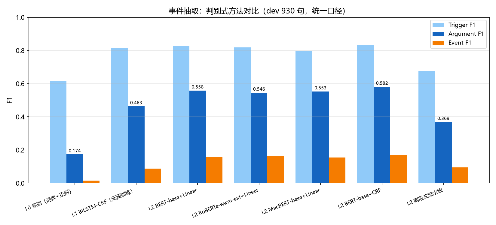
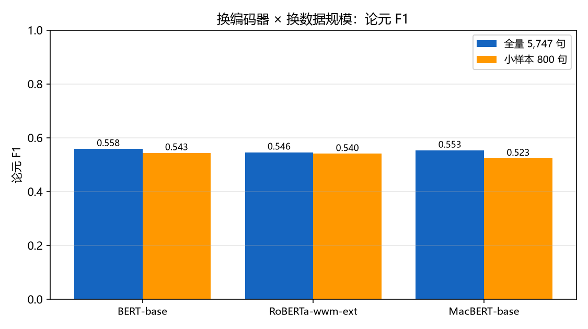
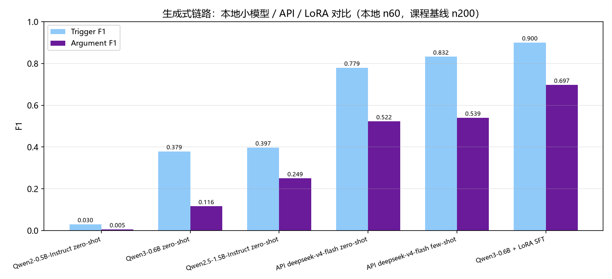

# Week07 事件抽取：换模型 / 换数据 / 换生成式模型 对比

> 数据：DuEE-Fin 派生，dev_extract 930 句（一句一事件，13 类型 / 92 槽位 / 61 角色）。
> 指标：`common/evaluate_events.py` 统一口径（trigger / argument / event 三级 F1）。

## 1. 判别式方法主表（dev 930 句）

| 方法 | 触发词F1 | 论元F1 | 事件F1 | 类型macroF1 | 参数M | 训练s | 延迟ms/句 | 非法BIO |
|---|---|---|---|---|---|---|---|---|
| L0 规则（词典+正则） | 0.6168 | 0.1740 | 0.0161 | 0.8118 | 0 | 0 | 1.577 | - |
| L1 BiLSTM-CRF（无预训练）（课程基线） | 0.8165 | 0.4634 | 0.0885 | 0.7306 | 1.31 | 1520.1 | 20.56 | 48.8% |
| L2 BERT-base+Linear | 0.8278 | 0.5585 | 0.1578 | 0.7576 | 102.4 | 418.3 | 7.0 | 65.9% |
| L2 RoBERTa-wwm-ext+Linear | 0.8181 | 0.5457 | 0.1617 | 0.7653 | 102.4 | 439.2 | 7.27 | 69.9% |
| L2 MacBERT-base+Linear | 0.7989 | 0.5529 | 0.1548 | 0.7439 | 102.4 | 441.5 | 7.63 | 67.5% |
| L2 BERT-base+CRF（课程基线） | 0.8320 | 0.5815 | 0.1697 | 0.7741 | 102.4 | 2742.5 | 74.28 | 62.5% |
| L2 两段式流水线（课程基线） | 0.6769 | 0.3690 | 0.0957 | 0.5619 | - | 405.5 | 49.87 | - |

**换编码器（同一 decoder / 同一超参）**：
- RoBERTa-wwm-ext − BERT = -0.0128（论元 F1），事件 F1 +0.0039
- MacBERT-base − BERT = -0.0056（论元 F1），事件 F1 -0.0030

## 2. 换编码器 × 换数据规模

| 编码器 | 全量 论元F1 | 全量 触发词F1 | 小样本 论元F1 | 小样本 触发词F1 | 全量训练s |
|---|---|---|---|---|---|
| BERT-base | 0.5585 | 0.8278 | 0.5434 | 0.8324 | 418.3 |
| RoBERTa-wwm-ext | 0.5457 | 0.8181 | 0.5403 | 0.8162 | 439.2 |
| MacBERT-base | 0.5529 | 0.7989 | 0.5230 | 0.7823 | 441.5 |

## 3. 生成式链路（本地 / API / LoRA）

| 方法 | 样本数 | 触发词F1 | 论元F1 | 事件F1 |
|---|---|---|---|---|
| Qwen2-0.5B-Instruct zero-shot（n60） | 60 | 0.0296 | 0.0052 | 0.0000 |
| Qwen3-0.6B zero-shot（n60） | 60 | 0.3788 | 0.1159 | 0.0000 |
| Qwen2.5-1.5B-Instruct zero-shot（n60） | 60 | 0.3969 | 0.2495 | 0.0153 |
| API deepseek-v4-flash zero-shot（n200）（课程基线） | 200 | 0.7789 | 0.5224 | 0.0402 |
| API deepseek-v4-flash few-shot（n200）（课程基线） | 200 | 0.8321 | 0.5395 | 0.0852 |
| Qwen3-0.6B + LoRA SFT（n200）（课程基线） | 200 | 0.9000 | 0.6971 | 0.1850 |

