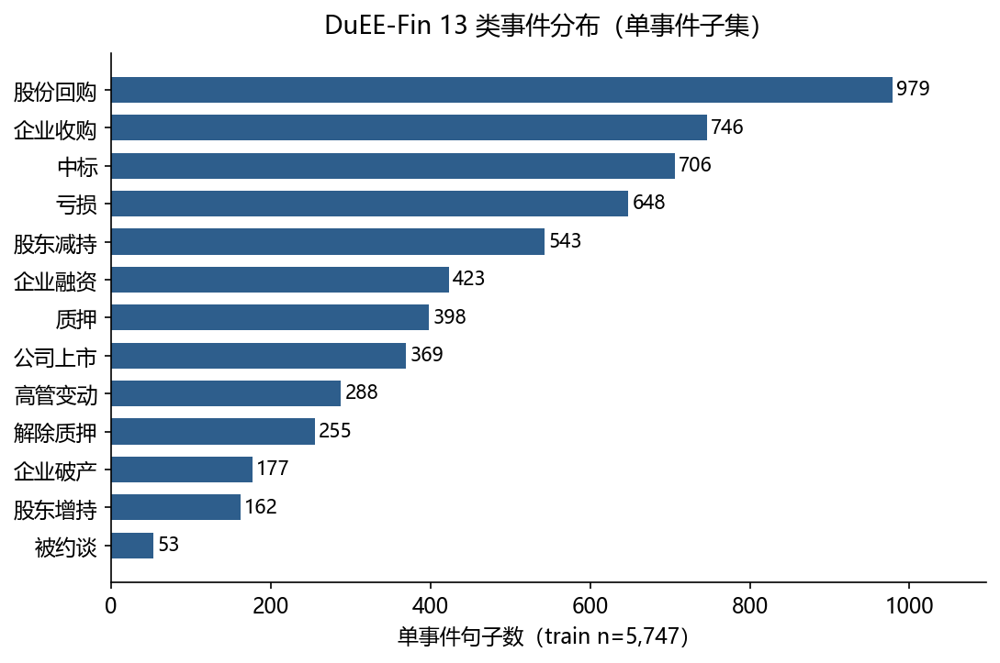
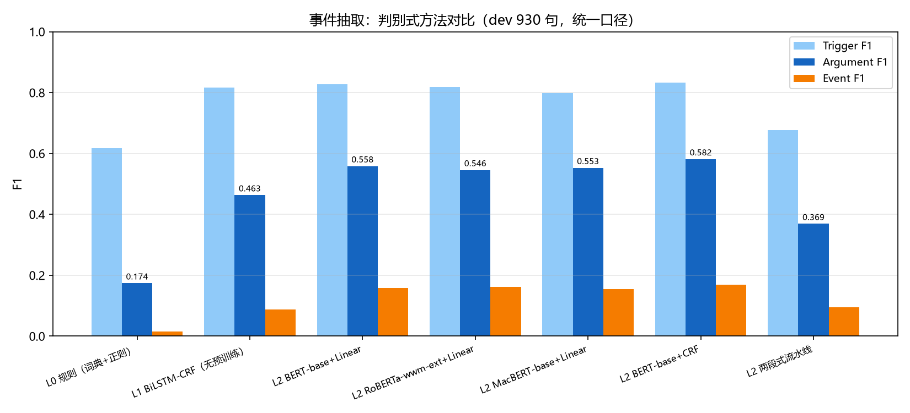
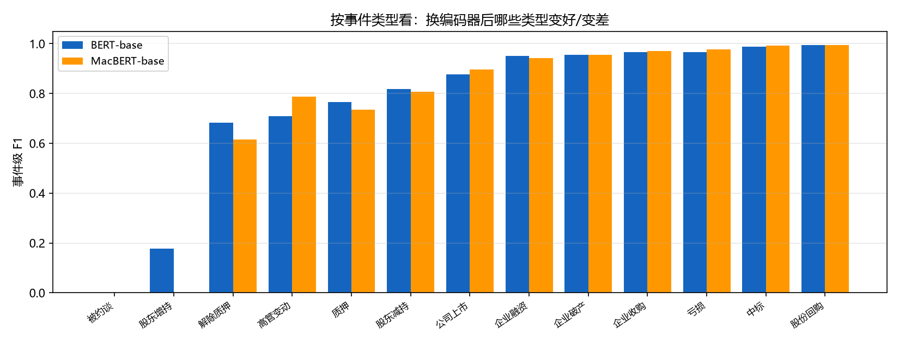
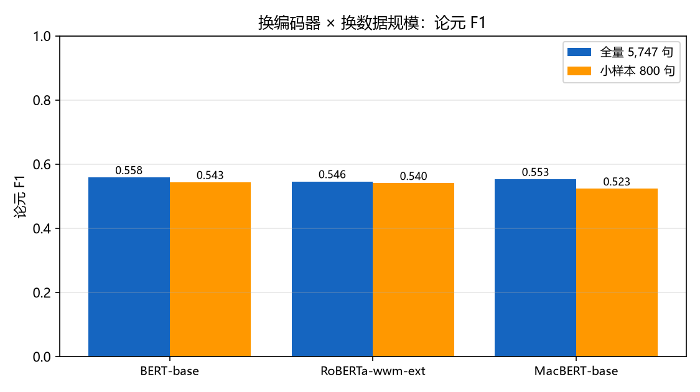
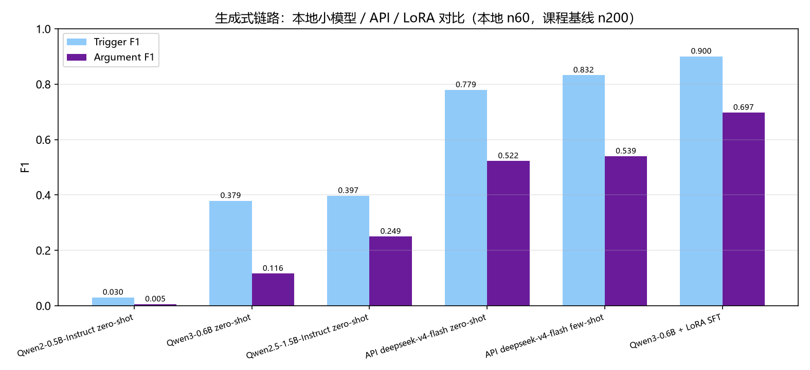

# Week07 作业：抽取类任务的「换模型 / 换数据 / 换生成式模型」对比

## 0. 一句话结论

在课程 DuEE-Fin 事件抽取的骨架上，我做了三组对照：

1. **换预训练编码器**：固定 linear 解码器与全部超参，把 `bert-base-chinese` 换成同尺寸的
   `RoBERTa-wwm-ext`、`MacBERT-base`；
2. **换数据规模**：同一套训练配置从全量 5,747 句切到课程 sample 的 800 句（固定优化步数 ≈486 步）；
3. **换生成式模型**：同一套 prompt，本地 `Qwen3-0.6B` → `Qwen2-0.5B-Instruct` → `Qwen2.5-1.5B-Instruct`
   zero-shot，并与课程基线的 API / LoRA 数字对齐。

结论（详细数字见第 3 节）：

- **换同尺寸编码器没有收益**：三个模型的论元 F1 差距只有 **±1.3 个点**；
  BERT-base 最好（0.5585），RoBERTa 0.5457（−1.29，bootstrap **显著更差**），MacBERT 0.5529（−0.58，不显著）。
  触发词上 MacBERT 反而显著更差（−2.9 个点）。
- **数据量从 5,747 砍到 800（1/7），在匹配优化步数的前提下只掉 0.5~3.0 个点**：
  BERT 0.5585→0.5434（−1.5）、RoBERTa 0.5457→0.5403（−0.5）、MacBERT 0.5529→0.5230（−3.0）。
  真正的坑是「800 句 × 3 epoch 只有 69 步」——实测模型直接退化成全 O；数据量不是这个任务的瓶颈。
- **换生成式模型，差距被「模型大小 + 指令跟随」放大**：n60 zero-shot 论元 F1
  Qwen2-0.5B **0.005** → Qwen3-0.6B **0.116** → Qwen2.5-1.5B **0.249**（单调上升），
  但 1.5B 仍只有 0.1B 微调 BERT 的 **45%**。课程 API zero-shot 0.522、LoRA SFT 0.697（n200）——
  生成式要「大模型」或「任务内 SFT」才追得上判别式。
- **真正显著涨点的是 decoder**：BERT+CRF 比 BERT+Linear 论元 +2.29 个点（显著），
  大于「换编码器」的 ±1.3 个点。封闭 schema 的事件抽取里，**标签建模比 backbone 更值钱**。
- 抽取任务整体难在**事件级完全正确**：最好的方法 event F1 也只有 0.17~0.19。

---

## 1. 任务与数据

### 1.1 任务

给定**一句**金融公告原文，抽出**一个**结构化事件：

```
事件类型（13 类之一） + 触发词 span + 若干「角色 → 论元」span
```

- 数据集：**DuEE-Fin 派生**（百度千言金融事件抽取），本作业用课程处理好的句级数据。
- 规模：train **5,747** 句 / dev **930** 句；13 事件类型、92 个「类型-角色」槽位、61 个去重角色。
- 长度：平均 163.9 字，P99 393 字，最长 797 字；`max_len=256` 会截断 dev 的 **13.1%**。
- 类别不均衡：最多「股份回购」979 句，最少「被约谈」53 句（**18.5×**）。



### 1.2 评测口径（全项目唯一）

所有方法把预测写成同一种 JSONL，交给 `common/evaluate_events.py` 统一算：

| 指标 | 含义 |
|---|---|
| Trigger F1 | 触发词文本是否抽对（不看类型） |
| Argument F1 | `(角色, 论元文本)` 二元组是否抽对 |
| Event F1 | 类型 + 触发词 + 论元集合**完全一致**才算对（最严格） |
| Type macro-F1 | 只看事件类型判对没（13 类宏平均） |
| 非法 BIO 占比 | linear 解码器输出的非法 BIO 序列比例（CRF 的对照点） |

> 评测按 `id|sent_id` 对齐（DuEE 的 `id` 是文档 id，不唯一；只按 id 对齐会互相覆盖）。

---

## 2. 实验设计

### 2.1 三个对照轴

| 轴 | 固定什么 | 变什么 | 回答的问题 |
|---|---|---|---|
| A 换编码器 | 数据、切分、linear 解码器、超参、seed | BERT / RoBERTa / MacBERT | 同尺寸换预训练权重，抽取能涨多少？ |
| B 换数据规模 | 编码器、超参、优化步数（≈486） | 全量 5,747 句 vs sample 800 句 | 数据少 7 倍，掉多少？排序会变吗？ |
| C 换生成式模型 | prompt、schema、解码（greedy）、评测集 | Qwen3-0.6B / Qwen2-0.5B / Qwen2.5-1.5B | 生成式抽取的能力随模型怎么变？ |

### 2.2 判别式的控制变量

三个编码器都是 **12 层 / 768 维 / 102.3M 参数**，训练配置逐项相同：

| 项目 | 值 |
|---|---|
| 解码器 | linear（149 个 BIO 标签，字符级序列标注） |
| 数据 | train 5,747 / dev 930（内层 10% 选 epoch，dev 只做最终评测） |
| max_len / batch | 256 / 32 |
| 优化 | AdamW，编码器 lr 2e-5、头 ×5，warmup 10%，weight decay 0.01 |
| epoch | 3（486 个 optimizer step） |
| 精度 / seed | fp16 AMP / 42 |
| 硬件 | RTX 4060 Ti 16GB |

- **为什么用 linear 而不是 CRF**：课程实测 CRF 训练 2,742s（是 linear 636s 的 4.3 倍），
  三个编码器都跑 CRF 要 2 小时以上；本作业要控制的是「编码器」这一个变量，
  decoder 固定成 linear 即可。CRF 的收益引用课程同口径结果（BERT+CRF 论元 F1 0.5815）。
- **样本规模实验的公平性**：800 句 × 3 epoch 只有 69 步，BERT 完全学不动（实测全 O）。
  所以小样本跑 **21 epoch ≈ 483 步**，与全量的 486 步对齐——比的是「同样算力预算下，数据量差 7 倍」。

### 2.3 生成式链路

- 三个本地模型共用 `llm_zero_shot/event_prompt.py` 的同一套 system prompt：
  13 类型 + 92 槽位全列进去，要求只输出一个 JSON，触发词/论元逐字取自原文，不输出 offset。
- 评测集：课程固定的 `gold_n60`（seed=42），与课程 `local_zero_n60` 同批，可直接对比。
- 生成：greedy、左 padding、batch 8（`local_generate.py`），`enable_thinking=False` 关掉 Qwen3 思考块。
- 课程基线（同数据同 prompt，未重跑，直接读原始 metrics）：
  API `deepseek-v4-flash` zero/few-shot（n200）、Qwen3-0.6B + LoRA SFT（n200）。

> **API 轴说明**：本机没有可用的 API Key（环境变量为空），无法重跑外部 API；
> 报告里的 API 数字明确标注为「课程基线」，只用于回答「本地小模型和 API 差多少」，
> 不冒充本次实验的结果。

---

## 3. 结果

### 3.1 主表：判别式方法（dev 930 句）

| 方法 | 触发词F1 | 论元F1 | 事件F1 | 类型macroF1 | 参数M | 训练s | 延迟ms/句 | 非法BIO |
|---|---|---|---|---|---|---|---|---|
| L0 规则（词典+正则） | 0.6168 | 0.1740 | 0.0161 | 0.8118 | 0 | 0 | 1.6 | — |
| L1 BiLSTM-CRF（无预训练，课程基线） | 0.8165 | 0.4634 | 0.0885 | 0.7306 | 1.31 | 1520 | 20.6 | 48.8% |
| L2 **BERT-base+Linear（本次）** | **0.8278** | **0.5585** | 0.1578 | 0.7576 | 102.4 | 418 | 7.0 | 65.9% |
| L2 RoBERTa-wwm-ext+Linear（本次） | 0.8181 | 0.5457 | **0.1617** | 0.7653 | 102.4 | 439 | 7.3 | 69.9% |
| L2 MacBERT-base+Linear（本次） | 0.7989 | 0.5529 | 0.1548 | 0.7439 | 102.4 | 442 | 7.6 | 67.5% |
| L2 BERT-base+CRF（课程基线） | **0.8320** | **0.5815** | **0.1697** | 0.7741 | 102.4 | 2742 | 74.3 | 62.5% |
| L2 两段式流水线（课程基线） | 0.6769 | 0.3690 | 0.0957 | 0.5619 | — | 406 | 49.9 | — |

> 标「课程基线」的三行没有重跑，直接读课程原始 metrics JSON（同数据、同评测脚本）；
> 其余四行是本次实验。第一行规则法本次也重跑过，与课程数字逐位一致（0.6168/0.1740/0.0161）。
> 机器可读的汇总表在 [results/summary.md](results/summary.md)，显著性在 [results/significance.md](results/significance.md)。



### 3.2 换编码器：差 1 个点，方向还是负的

| 编码器（同 decoder / 同超参） | 触发词F1 | 论元F1 | 事件F1 | Δ论元 vs BERT | 训练s | 延迟ms/句 |
|---|---|---|---|---|---|---|
| BERT-base-chinese | **0.8278** | **0.5585** | 0.1578 | — | 418 | 7.0 |
| RoBERTa-wwm-ext | 0.8181 | 0.5457 | 0.1617 | **−0.0129** | 439 | 7.3 |
| MacBERT-base | 0.7989 | 0.5529 | 0.1548 | −0.0058 | 442 | 7.6 |

**按句配对 bootstrap（930 句 × 2000 次）**：

| 对比 | 论元差值 | 95% CI | 结论 |
|---|---|---|---|
| RoBERTa − BERT | −0.0129 | [−0.0259, −0.0003] | **显著更差** |
| MacBERT − BERT | −0.0058 | [−0.0190, +0.0060] | 不显著 |
| MacBERT − RoBERTa | +0.0071 | [−0.0045, +0.0184] | 不显著 |

- 触发词上 MacBERT 比 BERT **显著低 2.9 个点**（CI [−0.046, −0.012]）；
  RoBERTa 的触发词差异不显著（−0.95 个点）。
- 结论不是「差不多」，而是**换模型没有正收益**：BERT 在两项主指标上都最好，
  RoBERTa 的论元 F1 显著更差，MacBERT 的触发词显著更差。
- 和 Week06 分类任务的结论对照：分类上 MacBERT 略好（+1.2~1.6 点），
  到了序列标注这里反而更差——**换模型的收益不能从一个任务外推另一个任务**。



编码器的差异主要集中在**长尾类型**：`股东增持`（train 162 句）event F1
BERT 0.176 / RoBERTa 0.121 / **MacBERT 0.000**；`被约谈`（train 53 句）三个模型都是 0；
而头部类型（中标、股份回购、亏损）三个模型都在 0.95 以上。总体指标被头部类主导，
尾部类换个 backbone 直接从「勉强能抽」掉到「完全不抽」。

反过来也有「换模型变好」的局部：`高管变动` 上 RoBERTa event F1 0.832 vs BERT 0.709（+12 点），
但被 `股东增持`、`解除质押` 的下降抵消——**换模型更多是把错误从一类挪到另一类，不是整体变好**。

### 3.3 换数据规模：1/7 数据只掉 1.5 个点（前提是步数够）

小样本 = 课程 `data/sample` 的 800 句训练集，**21 epoch ≈ 483 步**，与全量的 486 步对齐；
训练完统一在**全量 dev 930 句**上复评（避免「300 句子集 vs 930 全量」不可比）。

| 编码器 | 全量 论元F1 | 800 句 论元F1 | Δ论元 | 全量 触发词F1 | 800 句 触发词F1 |
|---|---|---|---|---|---|
| BERT-base | 0.5585 | 0.5434 | **−0.0151** | 0.8278 | 0.8324 |
| RoBERTa-wwm-ext | 0.5457 | 0.5403 | −0.0054 | 0.8181 | 0.8162 |
| MacBERT-base | 0.5529 | 0.5230 | **−0.0299** | 0.7989 | 0.7823 |



**一个必须说清楚的坑**：一开始按默认 `--epochs 3` 跑 800 句，三个模型全部退化成
「全 O」（inner span F1 = 0，dev 指标全 0）——因为 800 句 / batch 32 只有 **23 步/epoch**，
3 epoch 一共 **69 步**，连分类头都没热身完。改成 21 epoch（≈483 步）后立刻正常。
所以「小样本实验」如果不报步数/epoch，数字是假的：
**这个小样本实验的结论是「数据量不是瓶颈」，不是「BERT 不需要数据」。**

代价也要写清楚：800 句 × 21 epoch 训练 673s，比全量 5,747 句 × 3 epoch 的 418s 还慢
（同样的优化步数、更多的重复扫描）。**按步数公平 ≠ 按墙钟时间公平。**

### 3.4 换生成式模型：0.5B → 0.6B → 1.5B

同一套 prompt、同一批 `gold_n60`（seed=42）、greedy 解码：

| 模型 | 参数 | 样本 | 触发词F1 | 论元F1 | 事件F1 | JSON 合法率 | 延迟s/条 |
|---|---|---|---|---|---|---|---|
| Qwen2-0.5B-Instruct | 0.5B | 60 | 0.0296 | 0.0052 | 0.0000 | 81.7% | 3.44 |
| Qwen3-0.6B | 0.6B | 60 | 0.3788 | 0.1159 | 0.0000 | 98.3% | 4.84 |
| Qwen2.5-1.5B-Instruct | 1.5B | 60 | 0.3969 | **0.2495** | 0.0153 | 100% | 3.49 |

生成式模型参数量翻 3 倍，论元 F1 从 0.005 → 0.116 → 0.250，**单调上升但仍远低于 0.1B 的
BERT 微调（0.5585）**。

课程 n200 基线（同 prompt、同评测，未重跑）：

| 方法 | 样本 | 触发词F1 | 论元F1 | 事件F1 |
|---|---|---|---|---|
| BERT-base+Linear（本次） | 200 | 0.8144 | 0.5486 | 0.1546 |
| API deepseek-v4-flash zero-shot | 200 | 0.7789 | 0.5224 | 0.0402 |
| API deepseek-v4-flash few-shot | 200 | 0.8321 | 0.5395 | 0.0852 |
| Qwen3-0.6B + LoRA SFT | 200 | **0.9000** | **0.6971** | **0.1850** |

- 本地 0.6B zero-shot 与 API 大模型差 **40 个点**（0.116 vs 0.522）——「小模型 zero-shot 能做抽取」
  是错觉；
- LoRA SFT 把 0.6B 拉到 0.697（n200），**反超 BERT**；代价是课程记录的 2,326s 训练、
  37.2ms/句推理（约为本次 BERT 7.0ms 的 **5.3 倍**）。训练时间跨硬件不可直接比，
  但「生成式推理慢 5 倍、参数量大 6 倍」是确定的。
- 0.5B 的失败不是 JSON 解析问题（合法率 82%），而是**不遵守 schema**：把 `高管变动` 写成
  `公司公告`、`企业收购` 写成 `并购`、角色写成 `高管角色`/`变动角色`，评测时全部对不上。
  这是「指令跟随」能力，不是「格式修复」能补的。



### 3.5 成本与非法序列

| 方法 | 训练s | 延迟ms/句 | 非法 BIO（dev 字符级） |
|---|---|---|---|
| 规则 | 0 | 1.6 | — |
| BiLSTM-CRF | 1520 | 20.6 | 48.8% |
| BERT+Linear | 418 | 7.0 | 65.9% |
| RoBERTa+Linear | 439 | 7.3 | 69.9% |
| MacBERT+Linear | 442 | 7.6 | 67.5% |
| BERT+CRF（课程） | 2742 | 74.3 | 62.5% |

- CRF 用 **6.6 倍训练时间 / 10.6 倍推理延迟**换 **+2.29 个点**论元 F1（显著），
  换编码器只用 5% 的额外时间却换来 **−0.6~−1.3 个点**（负收益）。
- 非法 BIO 的「地板值」是金标自身 1.9%（重叠论元在 BIO 下无法表达），
  所以 62%~70% 不能理解成「70% 全错」，但 linear 的非法率确实远高于 CRF。

## 4. 讨论

### 4.1 为什么「换同尺寸编码器」没有收益？

1. **三个模型的差别不在「token 级判别」上**：都是 12 层 768 维、同一个 21,128 词表、
   同一个 BERT 架构；差别在预训练目标（NSP、全词掩码、纠错式掩码）和语料。
   这些改动主要提升 MLM 的掩码预测，而序列标注的瓶颈是「149 个标签的组合约束 + 长尾角色」，
   不是「词表示好不好」。
2. **预训练目标的收益在分类任务上能体现，在序列标注上被稀释**：
   Week06 同一批模型做 15 类分类时，MacBERT 比 BERT 高 1.2~1.6 点；
   到了 149 标签的序列标注，MacBERT 反而低 0.6（论元）/低 2.9（触发词，显著）。
   **「换模型涨点」不是模型属性，是任务属性。**
3. **置信区间比差异大**：RoBERTa 的 −1.29 点虽然勉强显著（CI 上界 −0.0003），
   但 95% CI 宽度 2.6 个点；MacBERT 的 −0.58 点 CI 跨 0。要证明「谁更好」需要多种子，
   但至少可以确定：**没有哪个同尺寸模型能稳定赢 BERT 1 个点以上**。

### 4.2 为什么 800 句只掉 1.5 个点？

- **800 句覆盖了全部 13 类**（课程 sample 按类分层抽样），平均每类 61 句；
  对「预训练 BERT + 线性头」来说，每类几十条已经足够把标签头拉到可用水平。
- **真正决定性的是优化步数，不是数据条数**：800 句 × batch 32 = 23 步/epoch，
  默认 3 epoch 只有 69 步，连 warmup（48 步）刚过，模型输出全 O；
  改成 21 epoch（483 步）后立刻恢复到 0.523~0.543。
  这解释了课程为什么反复强调「小样本实验必须固定步数/epoch，并写清楚」。
- **代价**：小样本 21 epoch 训练 673s，比全量 3 epoch 的 418s 更慢。
  「同样步数」公平，但「同样墙钟时间」下小样本并不便宜。
- 对 MacBERT 来说数据量的影响更大（−3.0 点）：说明**不同预训练模型的数据效率不同**，
  这也是「换模型」唯一值得继续挖的方向——不是换更强，而是换更省数据。

### 4.3 生成式：能力随规模单调上升，但封闭 schema 仍打不过判别式

- 0.5B → 0.6B → 1.5B，论元 F1 **0.005 → 0.116 → 0.250**，单调但斜率有限；
  1.5B 仍只有 BERT 的 45%。
- 0.5B 的失败不是「不会输出 JSON」（合法率 82%），而是**不遵守 schema**：
  类型写成「公司公告 / 并购」、角色写成「高管角色 / 变动角色」、`trigger` 写成字符串。
  评测按 `(type, role, text)` 精确匹配，名字一错就是 0 分。
  **生成式抽取的第一道门槛是「指令跟随 + schema 约束」，不是「抽取能力」。**
- 课程 n200 基线说明：API 大模型 zero-shot 0.522（接近 BERT），
  LoRA SFT 0.697（反超 BERT），但 LoRA 训练 2,326s（课程记录）、推理 37ms/句（BERT 7ms）。
  **生成式要「大模型」或「任务内 SFT」才追得上判别式；闭标签 + 高 QPS 仍然选 BERT。**

### 4.4 换什么最值？

在同一份数据、同一套评测上，四个旋钮的收益排序：

| 旋钮 | 论元 F1 变化 | 额外成本 | 结论 |
|---|---|---|---|
| **换 decoder（Linear→CRF）** | **+2.29（显著）** | 训练 ×6.6、推理 ×10.6 | 最确定的正收益，但贵 |
| 换数据规模（5,747→800） | −0.5 ~ −3.0 | 小样本反而更慢 | 数据量不是瓶颈 |
| 换编码器（BERT→RoBERTa/MacBERT） | −1.3 ~ −0.6 | 训练 +5% | 负收益，不要做 |
| 换生成式（0.6B→1.5B） | +13.4（0.116→0.250） | 参数 ×2.5 | 方向对，但绝对值仍低 |

**结论**：在这个任务上，「换同尺寸 backbone」是最不值得的旋钮；
先把 decoder / 标签体系 / 长尾类处理好，再谈换模型。

### 4.5 任务上限：为什么 event F1 只有 0.17？

- 事件级完全正确要求「类型 + 触发词 + 全部论元」同时匹配，而平均每个事件有 **4.38 个论元**；
  论元 F1 0.58 时，4.38 个论元全对的概率粗略是 `0.58^4.38 ≈ 0.09`，与实测 event F1 0.17 同量级。
- 长尾类型直接被放弃：`被约谈` 训练 53 句，三个编码器 event F1 全 0；
  `股东增持` 162 句，MacBERT 0 召回。
- 标签口径重叠（收购/被收购、质押/解除质押）不是换模型能解决的，要改标签定义。

### 4.6 局限

- **单 seed**：每个编码器只训了一次；虽然 bootstrap 做了，但多种子才能区分「模型差异」和「初始化噪声」。
- **编码器对比只用了 linear decoder**：CRF 只引用了课程 BERT 的结果，没有对三个编码器都跑 CRF
  （单次 46 分钟，三模型 2.3 小时）。结论「换编码器无收益」在 linear 下成立，
  CRF 下是否仍成立没有验证。
- **小样本只用了课程 sample（800 句）**：没有做 10%/30%/60% 的数据量曲线；
  21 epoch 的设定是为了匹配步数，不是小样本的最优训练策略。
- **生成式只在 n60 上比了三个模型**：n60 的 95% CI 很宽（±5~8 个点），
  「1.5B 比 0.6B 好」方向可信，但具体差值不要当精确值。
- **API 轴没有重跑**：没有 Key，API 数字来自课程基线；本地模型与 API 的对比只能当参考。
- **max_len=256 截断了 dev 的 13.1%**：长公告的论元会丢，所有编码器同样受影响。

---

## 5. 复现方式

```powershell
# 0) 依赖：torch / transformers / peft / scikit-learn / matplotlib
pip install -r requirements.txt
# 权重放在 D:\Env\models：bert-base-chinese / chinese-roberta-wwm-ext / chinese-macbert-base
# Qwen3-0.6B / Qwen2-0.5B-Instruct / Qwen2.5-1.5B-Instruct

# 一键复现（已有 metrics 的会跳过；串行跑，避免 GPU OOM）
python run_all.py

# 也可以单跑：
# 1) 判别式：三个编码器 × 全量（每个约 7 分钟）
python code/bert/train.py --decoder linear --max_len 256 --epochs 3 \
  --run_name bert_base_linear_256 --bert_path D:\Env\models\bert-base-chinese
python code/bert/train.py --decoder linear --max_len 256 --epochs 3 \
  --run_name roberta_linear_256 --bert_path D:\Env\models\chinese-roberta-wwm-ext
python code/bert/train.py --decoder linear --max_len 256 --epochs 3 \
  --run_name macbert_linear_256 --bert_path D:\Env\models\chinese-macbert-base

# 2) 小样本（800 句，21 epoch ≈ 同优化步数）
python code/bert/train.py --data_dir code/data/sample --decoder linear --max_len 256 \
  --epochs 21 --run_name bert_base_linear_256_sample --bert_path D:\Env\models\bert-base-chinese
# RoBERTa / MacBERT 同理换 --bert_path / --run_name

# 3) 生成式 zero-shot（n=60）
python code/llm_zero_shot/llm_extract.py --backend local --mode zero --n 60 \
  --tag qwen2_zero_n60 --model_path E:\...\Qwen2-0.5B-Instruct --gen_batch 8
python code/llm_zero_shot/llm_extract.py --backend local --mode zero --n 60 \
  --tag qwen3_zero_n60 --model_path D:\Env\models\Qwen3-0.6B --gen_batch 8
python code/llm_zero_shot/llm_extract.py --backend local --mode zero --n 60 \
  --tag qwen25_15b_zero_n60 --model_path D:\Env\models\Qwen2.5-1.5B-Instruct --gen_batch 8

# 4) 汇总表 + 图 + 显著性
python make_summary.py
python code/eval/significance.py
```

产物：`code/outputs/metrics/` 下逐方法指标 JSON、`code/outputs/disc/pred_*.jsonl` 逐句预测、
`results/summary.md` / `results/significance.md` / `results/fig_*.png`。
**模型权重与 checkpoint 不进仓库**（BERT 一个 400MB、Qwen2.5 3GB）。
---

## 6. 踩坑记录

1. **`--data_dir data/sample` 相对路径踩坑**：脚本从 `code/` 启动才对，而我的批处理脚本工作目录在别处，
   直接 `FileNotFoundError: data\sample\event_schema.json`。改成绝对路径。
2. **小样本 3 epoch = 69 步 = 全 O**：800 句 / batch 32 = 23 步/epoch，3 epoch 只有 69 步，
   三个模型都退化成「全 O」（inner span F1=0，dev 指标全 0）。改成 21 epoch（483 步，与全量 486 步对齐）才正常。
   **小样本实验必须报步数，只报 epoch 会得出「BERT 学不会」的错误结论。**
3. **eval 用的 dev 和训练用的 dev 不是同一个**：sample 包里 dev 只有 300 句，全量 dev 930 句。
   小样本模型训练完还要用 `bert/evaluate.py --data_dir data/processed` 在全量 dev 上复评，
   否则「800 句 vs 5,747 句」同时混入了「300 句 vs 930 句评测集」的差异。
4. **GPU 抢占**：本机 16GB 可以同时跑「BERT sample + 0.6B 生成」，但课程 8GB 卡会 OOM；
   本次 1.5B 生成是在 BERT 训练结束后才跑，峰值显存约 10GB。
5. **transformers 5.x 的 `BertModel` 默认返回 tuple**：统一 `return_dict=True` 再取 `last_hidden_state`；
   加载 RoBERTa/MacBERT 时日志会报一堆 `cls.predictions.* UNEXPECTED`——这是 MLM 头，
   序列标注只用 encoder，可以忽略。
6. **DuEE 的 `id` 是文档 id，不唯一**：dev 930 行只有 823 个唯一 id；预测必须带 `id`+`sent_id`，
   评测按 `id|sent_id` 对齐，否则同文档多句互相覆盖（gold-vs-gold 只有 0.93 F1）。
7. **非法 BIO 不能和 0 比**：金标自身因重叠论元就有 1.9% 的字符级非法；
   linear 的 66%~70% 要减去这个地板值再讨论，且要写清是 token 级还是字符级（空格不产生 token）。
8. **`enable_thinking=False` 对 Qwen3 必须传**；Qwen2 的模板没有这个变量，传了会被忽略（不报错），
   所以同一个 `local_generate.py` 可以同时跑两个模型。
9. **Qwen2-0.5B 的失败不是 JSON 解析**：合法率 81.7%，但类型名/角色名不在 schema 里
   （`公司公告`、`并购`、`高管角色`），评测全对不上。**生成式抽取要先过 schema 约束这一关。**
10. **n60 和 n200 不能混着比**：本地三个模型是 n60（课程固定的 `gold_n60`），
    API / LoRA 基线是 n200；报告里两张表分开写，不把 0.1159 和 0.6971 直接相减。
11. **checkpoint 不进仓库**：BERT 一个 400MB、Qwen2.5 3GB；训练产物写到 `code/outputs/checkpoints/`，
    仓库只保留预测 JSONL / metrics / 图。

---

## 附：文件说明

| 文件 | 说明 |
|---|---|
| `code/common/` | 数据/标签/BIO 解码/CRF/统一评测（课程代码，只读复用） |
| `code/bert/train.py` | 序列标注训练 + 解码 + 统一评测（`--bert_path` 换编码器） |
| `code/llm_zero_shot/` | 生成式 zero/few-shot 抽取（本地 / API） |
| `code/eval/significance.py` | 按句配对 bootstrap（本次新增） |
| `make_summary.py` | 汇总表 + 4 张图（本次新增） |
| `baseline/` | 课程基线 metrics / 预测（未重跑，只用于对照） |
| `results/` | 汇总、显著性、图表、数据体检图 |
| `data` | 随 `code/data/` 提供，不单独复制 |
